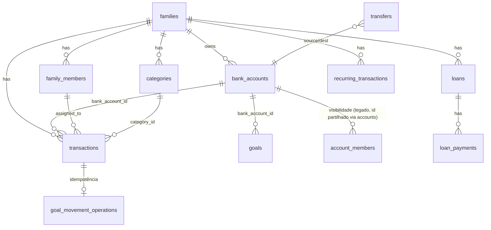

# Arquitetura — HomeFund ("expense")

> Documento descritivo produzido pela auditoria de 2026-11-23 (commit `9543949`). Descreve o que o código **faz hoje**, não o que o README afirma. Onde não inspecionei, está assinalado como **(não verificado)**. Achados de problemas: ver [`AUDIT.md`](./AUDIT.md).

## 1. Visão geral

Aplicação web de finanças domésticas multi-utilizador: famílias com membros (reais, fictícios ou "utilizadores API"), contas bancárias com visibilidade por utilizador, categorias, transações (receita/despesa/transferência), recorrências, metas de poupança e empréstimos. UI em Next.js (App Router) com PWA *manifest*; dados em Supabase (Postgres + Auth).

## 2. Stack e versões

| Camada | Tecnologia | Versão (`package.json`) |
|---|---|---|
| Framework | Next.js (App Router, `next build --webpack`) | 16.2.1 |
| UI | React | 19.2.4 |
| Estilos | Tailwind CSS v4 + `globals.css` (1923 l.) + `themes.css` (1547 l.) | ^4 |
| Dados no cliente | SWR | ^2.4.1 |
| Gráficos | Recharts | ^3.8.0 |
| Auth/BD | Supabase (`@supabase/supabase-js` ^2.100, `@supabase/ssr` ^0.9) | — |
| Linguagem | TypeScript `strict` | ^5 |
| Testes | `tsx --test` (Node test runner) | — |
| Lint | ESLint 9 + `eslint-config-next` 16.2.1 | — |
| Fontes | 7 famílias Google via `next/font` (Geist, Geist Mono, Manrope, Space Grotesk, DM Sans, DM Serif Display, Cormorant Garamond) | — |
| Backend extra | 2 Supabase Edge Functions (Deno) | — |

Nota: o `AGENTS.md` do repositório avisa que esta versão do Next tem alterações de ruptura e manda ler `node_modules/next/dist/docs/` — existe após `npm install` (confirmado: `01-app/01-getting-started/16-proxy.md` descreve `proxy.ts`, o antigo middleware).

## 3. Mapa do repositório

```
src/
  app/
    layout.tsx            raíz: fontes, script de tema, ThemeProvider + AppProvider
    page.tsx              redirect → /dashboard (único Server Component de página)
    manifest.ts, icon.png PWA manifest + ícones (public/icons/*)
    (auth)/login|register Formulários cliente → supabase.auth.signInWithPassword/signUp
    dashboard|transactions|accounts|categories|goals|loans|recurring|families/page.tsx
                          Todas "use client" + SWR → /api/*
    api/                  Route Handlers (10 recursos; ver §6)
    actions/              Server Actions legadas (possível código morto)
  components/             AppNav, AppDialog, PrettySelect, TransactionWizard (905 l.),
                          Goal*/Loan*/Account* forms/cards, gráficos (FamilyCharts, LoanCharts)
  context/                AppState (user, famílias, contas, seleção; SWR), ThemeContext
  lib/                    api-auth (autorização), supabase-{admin,server,browser},
                          member-kind/member-tags/goal-moves (tags e kind),
                          transaction-balance, cash-flow-trend, financial-totals,
                          goal-movement-{state,idempotency}, format, theme-preferences, *.test.ts
supabase/
  sql/01–14               migrações manuais (faltam 12, 13)
  functions/              create-transaction (legado), recurring-runner
docs/audit/               (este relatório)
```

## 4. Diagrama de execução

```mermaid
flowchart LR
  subgraph Browser
    UI[Páginas "use client"<br/>SWR + AppState]
    SB[supabaseBrowser<br/>anon key, cookies via @supabase/ssr]
  end
  subgraph Next["Next.js server (Route Handlers)"]
    API["/api/* handlers"]
    AUTH["api-auth.ts<br/>getRequestUser + ensure*"]
    ADMIN["supabaseAdmin()<br/>service_role (server-only)"]
  end
  subgraph Supabase
    GA[Auth / GoTrue]
    PG[(Postgres)]
    RPC["apply_goal_movement_v1<br/>(SECURITY DEFINER)"]
    EF["Edge Function<br/>recurring-runner (cron?)"]
  end
  UI -- signIn/signUp --> SB --> GA
  UI -- fetch + Bearer + cookie --> API
  API --> AUTH --> ADMIN
  AUTH -- admin.auth.getUser / getUserById / listUsers --> GA
  ADMIN -- CRUD (RLS ignorada) --> PG
  API -- rpc --> RPC --> PG
  EF -- service_role --> PG
```

Pontos-chave:
- **O browser nunca lê a BD diretamente** (o cliente `supabaseBrowser` só é usado para auth e para obter o `access_token`). Todos os dados passam pelas rotas `/api/*`.
- **Todas as rotas usam `service_role`** (`supabase-admin.ts`) → a RLS não é a barreira de segurança; a autorização é código aplicacional (`api-auth.ts`).
- `getRequestUser` aceita `Authorization: Bearer <jwt>` (validado com `admin.auth.getUser(token)`) ou cookie de sessão (`supabase.auth.getUser()`).

## 5. Modelo de dados

### 5.1 Duas gerações coexistentes

| Geração | Tabelas | Estado |
|---|---|---|
| **Legada** (`01–05`) | `accounts`, `account_members`, `transactions(account_id,user_id,category text…)`, `goals(user_id…)`, `loans(account_id…)`, `loan_payments` | Ainda **usada**: `account_members` guarda a *visibilidade por conta* da geração nova; `accounts` é um **espelho** de `bank_accounts` mantido em cada escrita (`ensureLegacyAccountForBankAccount`) porque colunas legadas continuam `NOT NULL`/FK. |
| **Famílias** (`06–11`, `14`) | `families`, `family_members(kind?)`, `bank_accounts(balance)`, `categories(color, affects_loan)`, `transactions(family_id, bank_account_id, assigned_to, category_id…)`, `transfers`, `goals(bank_account_id)`, `loans(family_id, remaining_amount)`, `recurring_transactions`, `goal_movement_operations` | Modelo principal. |



### 5.2 Conceitos importantes

- **Saldo** = coluna `bank_accounts.balance` (valor armazenado, atualizado pela API a cada movimento; ver AUDIT F-04). O "saldo após" por transação (`balance_after`) é recalculado por *replay* (`lib/transaction-balance.ts`).
- **Visibilidade de conta:** `account_members` (por `account_id` = id da `bank_account`). Sem linhas ⇒ visível a todos os membros; com linhas ⇒ só aos listados. Utilizadores `kind = system` vêem tudo.
- **Papéis:** `family_members.role` (`owner`/`member`) e `account_members.role`. Tipo de membro: `human` | `system` (utilizador API; guardado em `family_members.kind` **e** em metadados Supabase Auth — ver AUDIT F-02).
- **Metadados em texto livre** dentro de `transactions.description`: `[goal:id]`, `[goal-move:allocate|release|spend]`, `[loan:id]`, `[transfer:id:source|dest]`, `[recurring:id:data]`, `[members:id,id]` (AUDIT F-07).
- **Transferência** = 1 linha em `transfers` + 2 linhas em `transactions` (tipo `transfer`, uma por conta, marcadas com tag e lado). Saldo: `-amount` na origem, `+amount` no destino.
- **Movimentos de meta** (`allocate`/`release`/`spend`): único fluxo atómico, via RPC `apply_goal_movement_v1` (bloqueios `FOR UPDATE`, idempotência em `goal_movement_operations`, valores em cêntimos). O cliente gera `Idempotency-Key` UUID e persiste operações pendentes em `localStorage` (`lib/goal-movement-idempotency.ts`).
- **Recorrências:** `recurring_transactions.frequency` (`every:N:day|week|month|year`, com sinónimos legados), `next_execution_date`. Materialização por 3 mecanismos (§7.4).

## 6. Superfície de API (`src/app/api/*/route.ts`)

Todas exigem sessão (`getRequestUser`); `familyId` sai do corpo/query. "Autorização" resume o que o código verifica.

| Recurso | Métodos | Autorização observada |
|---|---|---|
| `/api/families` | GET, POST, PATCH, DELETE | GET: próprias; POST: qualquer utilizador autenticado (cria família + owner); PATCH/DELETE: `ensureFamilyOwner` |
| `/api/family-members` | GET, POST, PATCH, DELETE | GET: membro; escrita: `ensureFamilyOwner`; cria/atualiza utilizadores `system` no Supabase Auth |
| `/api/bank-accounts` | GET, POST, PATCH, DELETE | POST/PATCH(nome,saldo)/DELETE: **só membro** (AUDIT F-01); permissões de visibilidade: `ensureAccountOwner` |
| `/api/categories` | GET, POST, PATCH, DELETE | membro da família |
| `/api/transactions` | GET (paginado, filtros), POST, PATCH, DELETE | membro + acesso à conta (`getAccessibleAccountIds`); gere transferências e movimentos de meta/empréstimo por tags |
| `/api/recurring-transactions` | GET, POST (`action:"recalculate"` ou criar), PATCH, DELETE | membro + acesso à conta; GET/recalculate **escrevem** (AUDIT F-05) |
| `/api/goals` | GET, POST, PATCH, DELETE | membro + acesso à conta; movimentos exigem `Idempotency-Key` e chamam o RPC |
| `/api/loans` | GET, POST, PATCH, DELETE | membro + acesso à conta |
| `/api/loan-payments` | POST, DELETE | membro + acesso à conta |
| `/api/dashboard` | GET | membro; agregações por contas acessíveis |

Server Actions (`src/app/actions/{accounts,families}.ts`): `inviteMember`, `createFamily`, `addMember` — **não referenciadas pela UI** (código morto provável; AUDIT F-03).

## 7. Fluxos principais

### 7.1 Autenticação
1. `/register` ou `/login` chamam `supabaseBrowser().auth.signUp / signInWithPassword` → cookies de sessão (`@supabase/ssr`).
2. `AppProvider` (`context/AppState.tsx`) subscreve `onAuthStateChange`, carrega `GET /api/families` e `GET /api/bank-accounts?familyId=…` com SWR, e guarda família/conta selecionada em `localStorage`.
3. Cada `fetch` envia `Authorization: Bearer <access_token>` (de `getSession()`) **e** cookies. Não existe `proxy.ts`; o único *guard* de rota é um `useEffect` em `families/page.tsx`.

### 7.2 Criar transação (`POST /api/transactions`)
validar sessão → `ensureFamilyMember` → `ensureAccountAccess(origem)` → validar conta/categoria/empréstimo/membros da família → `ensureLegacyAccountForBankAccount` → *(transferência: insere `transfers` + 2 `transactions`)* ou insere `transactions` → `applyBalanceDelta` (**read-modify-write**) → se categoria `affects_loan`, atualiza `loans.remaining_amount` (idem). Sem transação de BD.

### 7.3 Movimento de meta (`PATCH /api/goals` com `movement_*`)
Idempotency-Key obrigatória → `registerGoalMovement` → RPC `apply_goal_movement_v1` (tudo numa transação: meta, conta, empréstimo, linha em `transactions`, registo de operação) → resposta com `replayed`.

### 7.4 Recorrências (três escritores)
1. **Browser:** `AppState` dispara `POST /api/recurring-transactions {action:"recalculate"}` no máximo a cada 5 min por família (`localStorage`).
2. **API:** o `GET` e o `recalculate` materializam ocorrências em atraso (`materializeRecurringBackfill`, id determinístico SHA-256) e correm `cleanupRecurringDuplicates` (apaga duplicados por tag).
3. **Edge Function `recurring-runner`:** pensada para cron diário (README); id aleatório, dedupe por `ILIKE`. **Estado do agendamento: não verificado.**

### 7.5 Dashboard
`GET /api/dashboard` devolve membros, contas (com `member_ids`/`is_shared`), categorias, empréstimos, até **1000** transações do período, uso por categoria e totais de recorrentes do mês; o cliente (`FamilyCharts`, `lib/cash-flow-trend`, `lib/financial-totals`) deriva gráficos. (Linhas 420–648 da rota e os componentes de gráfico **não foram lidos**.)

## 8. Estado e UI

- **Server vs client:** só `app/page.tsx` é Server Component. As restantes páginas são clientes que buscam dados via SWR (`cache: "no-store"`).
- **Estado global:** `AppProvider` (utilizador, famílias, contas, seleção) + `ThemeProvider` (modo claro/escuro + 1 de N temas visuais, persistidos em `localStorage`; script inline no `<head>` evita *flash*).
- **Componentes próprios:** `AppDialog/ConfirmDialog` (portal), `PrettySelect`, `EntityPopover`, `SafeResponsiveContainer`.
- **PWA:** `manifest.ts` + ícones normais e *maskable*; **sem service worker** (não instalável offline).
- **Formatação:** `Intl.NumberFormat("pt-PT","EUR")` fixo; `<html lang="en">`.

## 9. Integrações e dependências externas

| Integração | Uso | Risco/nota |
|---|---|---|
| Supabase Auth | email/password; `admin.auth.*` (getUser, getUserById, listUsers, createUser, updateUserById, deleteUser) | `listUsers` por pedido (AUDIT F-13) |
| Supabase Postgres + PostgREST | CRUD via `service_role`; 1 RPC | RLS não efetiva (F-09) |
| Supabase Edge Functions | `recurring-runner`, `create-transaction` | deploy e `verify_jwt` não verificados |
| Google Fonts (via `next/font`) | 7 famílias | auto-hospedadas no build |
| Recharts / SWR | gráficos / cache cliente | — |
| Nenhuma: pagamentos, bancos (Open Banking), email transacional, analytics, observabilidade | — | ver IMPROVEMENTS |

**Variáveis de ambiente (nomes apenas):** `NEXT_PUBLIC_SUPABASE_URL`, `NEXT_PUBLIC_SUPABASE_ANON_KEY`, `SUPABASE_SERVICE_ROLE_KEY` (segredo crítico, server-only), opcionais `SUPABASE_URL`/`SUPABASE_ANON_KEY`. Sem `.env.example`.

## 10. Build, qualidade e operação

- Scripts: `dev`, `build` (`next build --webpack`), `start`, `lint`, `test`.
- `tsc` e `eslint` limpos; 30 testes passam (apenas `src/lib`).
- **Sem CI, sem Dockerfile, sem IaC, sem observabilidade (logs/erros/métricas), sem estratégia de backup documentada.** Alvo de deploy não definido no repositório (`.vercel` está no `.gitignore`, sugerindo Vercel — não confirmado).
- `next.config.ts`: apenas `allowedDevOrigins` com IP de LAN.

## 11. Dívida técnica estrutural (resumo)

1. Dois schemas + espelho `accounts` (F-08).
2. Saldo armazenado e atualizado sem transação (F-04).
3. Tags em texto livre como modelo relacional (F-07).
4. Autorização manual repetida por rota; RLS inoperante (F-01, F-09).
5. Ficheiros gigantes e *fallbacks* por colunas em falta (F-22).
6. Páginas inteiramente cliente apesar do posicionamento "RSC-first" (F-21).

## 12. Não verificado

BD real e migrações aplicadas; configuração do Supabase (e-mail, `verify_jwt`, cron, `max-rows`); comportamento em runtime; renderização/responsividade; linhas não lidas listadas em `AUDIT.md §1.2`.
