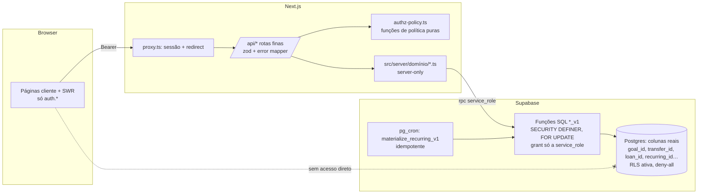
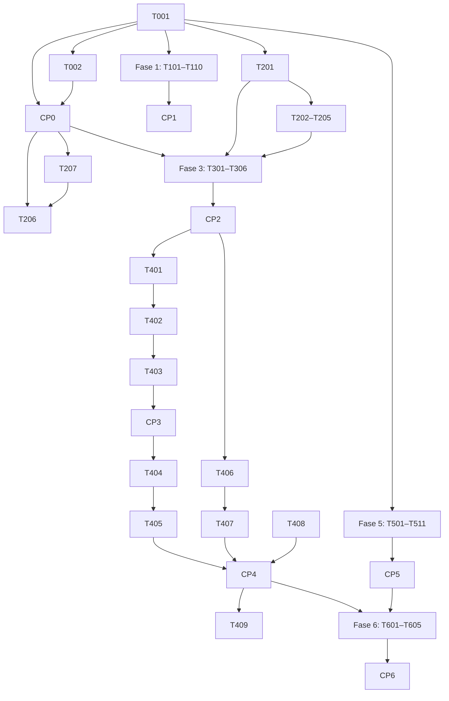

# HomeFund — Plano Mestre de Modernização

> Documento de planeamento. Baseado na auditoria em [`../audit/AUDIT.md`](../audit/AUDIT.md), [`../audit/ARCHITECTURE.md`](../audit/ARCHITECTURE.md) e [`../audit/IMPROVEMENTS.md`](../audit/IMPROVEMENTS.md). As tarefas executáveis estão em [`TASKS.md`](./TASKS.md).
>
> Este plano é **evolução, não reescrita**. Nenhum agente aplica SQL nem faz deploy: isso é sempre uma ação humana, num checkpoint.

## Índice

1. [Resumo executivo](#1-resumo-executivo)
2. [Validação da auditoria](#2-validação-da-auditoria)
3. [Classificação](#3-classificação)
4. [Arquitetura-alvo](#4-arquitetura-alvo)
5. [Fases e sequência](#5-fases-e-sequência)
6. [Checkpoints humanos (CP0 a CP6)](#6-checkpoints-humanos-cp0-a-cp6)
7. [Estratégia de rollback](#7-estratégia-de-rollback)
8. [Riscos globais e decisões de produto em aberto](#8-riscos-globais-e-decisões-de-produto-em-aberto)
9. [Métricas de sucesso](#9-métricas-de-sucesso)
10. [Convenções para agentes executores](#10-convenções-para-agentes-executores)

---

## 1. Resumo executivo

O HomeFund (Next.js 16.2.1 + Supabase) é uma aplicação de finanças familiares com páginas cliente + SWR e Route Handlers em `/api/*` que usam `service_role`. A auditoria identificou problemas reais em quatro eixos: **segurança** (escalada de privilégios via `user_metadata`, uma falha de isolamento entre famílias, dependências vulneráveis), **integridade financeira** (saldos alterados por *read-modify-write* em JavaScript, escritas em `GET`, mutações multi-passo sem transação), **modelo de dados** (metadados estruturais guardados como tags dentro de descrições de texto, camada legada duplicada, RLS inconsistente) e **UX/acessibilidade** (rótulos sem `htmlFor`, diálogos sem foco gerido, idiomas misturados, ausência de `error.tsx`).

Este plano valida a auditoria contra o código, **rebaixa ou elimina** o que não tem evidência ou é excessivo, acrescenta um achado novo (**N-01**, isolamento de metas entre famílias) e organiza o trabalho em **7 fases** (0 a 6) com **7 checkpoints humanos** (CP0 a CP6).

Princípios:

- **Estancar o risco primeiro** (Fase 1: só código da aplicação, sem SQL, reversível por `git revert`).
- **Integridade financeira por funções SQL atómicas** (`*_v1`), seguindo o padrão já existente em `supabase/sql/14_atomic_goal_movements.sql`.
- **Uma única dependência nova de runtime: `zod`.** Sem nova infraestrutura (sem Upstash, Sentry, pgTAP, etc.).
- **Mudanças aditivas na BD até ao CP4.** Os `DROP` só no T409 (opcional), com backup.
- **1 tarefa = 1 PR.** SQL e código incompatível nunca no mesmo PR.

Contagem: 2 tarefas de preparação, 10 de contenção de risco, 7 de fundações, 6 de integridade financeira, 9 de modelo de dados, 11 de UX/a11y e 5 de funcionalidades, mais 7 checkpoints.

---

## 2. Validação da auditoria

Cada achado foi verificado contra o código no commit `9543949`. Esta tabela é a **fonte final**: os executores não re-auditam nem mudam vereditos.

| ID | Veredicto | Evidência / ajuste |
|---|---|---|
| F-01 | **Confirmado, Alta** | `bank-accounts/route.ts`: DELETE e PATCH de `name`/`balance` só chamam `ensureFamilyMember`. Categorias: só membro. Como as categorias são um recurso partilhado da família, passam a **decisão de produto** (Baixa). |
| F-02 | **Confirmado, Alta (reforçado)** | `src/lib/member-kind.ts:12-16` lê `user_metadata`. A própria app escreve `user_metadata` a partir do browser (`ThemeContext.tsx:144`, `auth.updateUser({data})`), o que prova que o cliente o controla. `createSystemUser` já escreve `app_metadata`, por isso a correção é segura. |
| **N-01 (novo)** | **Alta** | `transactions/route.ts:971` (PATCH) e `:1524` (DELETE) carregam a meta indicada pela tag `[goal:uuid]` da descrição com `getGoal()` **sem verificar a família**, e o POST não remove tags `[goal:…]` (`:674`, `:713`). Quem conheça o UUID de uma meta de outra família pode alterar o `current_amount` dela. Os UUID são difíceis de adivinhar, o que atenua o risco. A auditoria dizia "dentro do âmbito da família", o que está errado. As transferências estão protegidas (`:1573`). |
| F-03 | **Rebaixado para Baixa** (código morto) | `actions/*` e 7 componentes (`TransactionForm`, `AccountCreateForm`, `AccountInviteForm`, `LoanForm`, `GoalForm`, `LoanCard`, `GoalCard`) têm 0 importações. São também os **únicos** sítios com `supabaseBrowser().from(...)`. |
| F-04 | Confirmado, Alta | `applyBalanceDelta` (`transactions/route.ts:241-256`): lê o saldo, soma em JS e escreve. Usado em 15+ pontos. |
| F-05 | Confirmado, Alta | `GET` com escritas (`recurring-transactions/route.ts:537`). Reconciliação disparada pelo browser (`AppState.tsx:232-262`). `setUTCMonth` com deriva de dias em 2 cópias. |
| F-06 | **Confirmado de forma independente** | `npm audit --package-lock-only`: 1 crítica (`next` ≤16.4.4, correção em 16.4.6) e 9 altas. |
| F-07 | Confirmado, junta-se a N-01 | Tags reservadas aceites no input do utilizador. |
| F-08 | Confirmado em substância | `family_members.kind` não é criado por nenhum SQL, mas o código insere-o (`family-members/route.ts:232`), logo **existe na BD real**. Faltam as migrações 12/13. Os números de linha citados para o SQL estão errados (`07` tem 83 linhas e cita 162; `14` tem 343 e cita 346). |
| F-09 | Confirmado; **solução simplificada** | Como o browser só usa `auth.*` (fora o código morto), a RLS passa a "deny-all" para `anon`/`authenticated`. Rejeita-se a reescrita de políticas e o pgTAP. |
| F-10 | Confirmado | `loan-payments/route.ts:246-251`. |
| F-11 | Confirmado (de PROVÁVEL a COMPROVADO no código) | `dashboard/route.ts:364` `.limit(1000)`; a consulta de uso por categoria não tem limite. |
| F-12, F-13, F-14 | Confirmados | F-13: `family_members.kind` existe, por isso `getAuthUserKindById` pode ser eliminado dos caminhos quentes. |
| F-15 | Mantido como PROVÁVEL | O runner não autentica o chamador; `create-transaction` é código morto. |
| F-16 | Mantido, prioridade média | Impacto sobretudo de UX: o Bearer token já mitiga. |
| F-17 | Headers: **sim**. Rate limiting (Upstash): **rejeitado** | Sem evidência de abuso e implica nova infraestrutura. Ficam os limites do Supabase Auth. |
| F-18 | Confirmado | O glob do script de teste funciona hoje (`src/lib/*.test.ts`); deve ser citado por robustez. |
| F-19, F-20, F-21 | Confirmados | 74 `<label>`, 0 `htmlFor`. O registo não trata a confirmação de email. Sem `error.tsx`. |
| F-22 | Confirmado; resolve-se por efeito das tarefas de RPC | Sem tarefa de "refactor puro". |
| F-23 | **Eliminado** (CSRF) | CSRF eliminado (Bearer + JSON + `SameSite=Lax`). Fuso horário absorvido pela tarefa de recorrências (T404). *Floats* absorvidos pelos RPC em `numeric`. |

### 2.1 Recomendações eliminadas ou adiadas

| Recomendação | Decisão | Justificação |
|---|---|---|
| Migração total para React Server Components | **Eliminada** | Reescrita enorme sem problema concreto que a justifique; o modelo atual (páginas cliente + SWR + `/api`) funciona. |
| Design system com Radix/shadcn | **Eliminada** | Nova dependência pesada. A acessibilidade resolve-se corrigindo `AppDialog` e `PrettySelect` (T502, T503). |
| `next-intl` / i18n completo | **Eliminada** | A app é PT-PT; basta uniformizar o idioma (T506, T507). |
| Rate limiting com Upstash | **Eliminada** | Sem evidência de abuso; implica infraestrutura nova. Ficam os limites do Supabase Auth. |
| Sentry / OpenTelemetry | **Eliminada** | Sem necessidade comprovada; o *error mapper* (T109) com `requestId` nos logs chega por agora. |
| pgTAP / reescrita de políticas RLS | **Eliminada** | A RLS "deny-all" (T408) torna as políticas desnecessárias. |
| PWA offline | **Adiada (backlog)** | Sem pedido de produto. |
| Open Banking | **Adiada (backlog)** | Fora de âmbito. |
| Multi-moeda | **Adiada (backlog)** | Fora de âmbito. |
| React Compiler | **Eliminada** | Sem problema de desempenho medido. |
| "Baseline único" do schema sem dump real | **Eliminada** | Impossível sem o dump real; o CP0 produz-o e só então se decide. |
| `authorize()` genérico | **Substituída** | Substituída por funções de política pequenas e puras (`src/lib/authz-policy.ts`). |
| Protecção CSRF explícita (F-23) | **Eliminada** | Bearer token + JSON + `SameSite=Lax` já mitigam. |

**Backlog explícito, não planeado em detalhe:** convites por email com token (F-14 completo), notificações, anexos, MFA, histórico de auditoria, PWA offline, multi-moeda, Open Banking.

**Ambiente:** não existe `node_modules` no repositório de trabalho, logo os guias do Next (`node_modules/next/dist/docs/`) só ficam disponíveis após `npm ci` (T001). Todas as tarefas que tocam em APIs do Next exigem lê-los primeiro (`AGENTS.md`: *"This is NOT the Next.js you know"*).

---

## 3. Classificação

### 3.1 Críticos (Fase 1: risco imediato, só código)

| Tarefa | Achado | Porquê é crítico |
|---|---|---|
| T101 | F-06 | `next` com vulnerabilidade crítica conhecida (≤16.4.4). |
| T102 | F-02 | Qualquer utilizador pode promover-se a `owner`/`system` via `user_metadata`. |
| T103 | N-01 | Alteração do `current_amount` de metas de outras famílias. |
| T104 | F-07 | Injeção de tags reservadas (`[goal:…]`, `[transfer:…]`, …) pelo input. |
| T105 | F-01 | Qualquer membro apaga contas e altera saldos. |
| T110 | F-15 | Runner de recorrências sem autenticação do chamador. |

### 3.2 Quick wins (esforço S, valor imediato)

| Tarefa | Descrição |
|---|---|
| T001 / T002 | `npm ci`, scripts, CI. |
| T106 | `GET` de recorrências deixa de escrever. |
| T107 | Remover código morto. |
| T108 | Headers de segurança e CSP em Report-Only. |
| T109 | *Error mapper* central. |
| T301 | RPC atómico de saldo (elimina *lost updates* nos 4 *read-modify-write*). |
| T501 | `error.tsx`, `not-found.tsx`, `loading.tsx`. |
| T506 / T507 | Idioma PT-PT e `lang="pt-PT"`. |
| T511 | Fontes sem *preload* desnecessário. |

### 3.3 Estruturais (esforço M, mudam a base)

| Tarefa(s) | Descrição |
|---|---|
| T201–T205 | Validação com `zod` por grupos de rotas. |
| T206, T207 | `kind` só em `family_members`; backfill, unicidade e índices. |
| T302–T305 | Mutações financeiras atómicas em SQL (`create/update/delete_transaction_v1`, `record/delete_loan_payment_v1`). |
| T401–T403 | Metadados em colunas reais (backfill, escrita dupla, leitura por colunas). |
| T404, T405 | Executor único de recorrências em SQL + `pg_cron`. |
| T406, T407 | Retirada incremental da camada legada. |
| T408 | RLS deny-all. |
| T510 | `src/proxy.ts` (sessão + redirecionamento). |

### 3.4 Funcionalidades de alto valor (Fase 6)

| Tarefa(s) | Funcionalidade |
|---|---|
| T601 | Exportação CSV de transações. |
| T602, T603 | Orçamentos mensais por categoria + widget no dashboard. |
| T604 | Totais do dashboard em SQL (sem truncagem a 1000, resolve F-11). |
| T605 | Importação CSV com pré-visualização e deteção de duplicados. |

---

## 4. Arquitetura-alvo

**Evolução, não reescrita.**

### 4.1 O que NÃO muda

- Next App Router com páginas cliente + SWR.
- Route Handlers `/api/*` como única fronteira de dados; `service_role` só no servidor.
- CSS atual (sem novo design system).
- Autenticação Supabase (Bearer token enviado pelo cliente).
- SQL aplicado manualmente por um humano, em `supabase/sql/NN_*.sql`.

### 4.2 Antes

```mermaid
flowchart LR
  subgraph Browser
    P[Páginas cliente + SWR]
    AS[AppState: reconciliação de recorrências]
    DEAD[Código morto: actions + 7 componentes<br/>supabaseBrowser().from]
  end
  subgraph Next[Next.js Route Handlers]
    R[/api/* ficheiros gigantes<br/>autorização + lógica + SQL via supabase-js/]
    AUTH[api-auth.ts<br/>kind via user_metadata]
    BAL[applyBalanceDelta<br/>read-modify-write em JS]
  end
  subgraph Supabase
    DB[(Postgres: tags em descrições<br/>RLS inconsistente<br/>tabelas legadas duplicadas)]
    EF[Edge recurring-runner<br/>sem autenticação do chamador]
  end
  P -->|Bearer| R
  AS -->|POST recalculate| R
  DEAD -.->|anon key| DB
  R --> AUTH
  R --> BAL
  BAL -->|select + update| DB
  R -->|GET escreve| DB
  EF --> DB
```

### 4.3 Depois



### 4.4 Decisões de arquitetura

- **Mutações financeiras** passam a funções SQL `*_v1` (`SECURITY DEFINER`, `search_path` fixo, `REVOKE` a `public/anon/authenticated`, `GRANT` a `service_role`), seguindo `14_atomic_goal_movements.sql`. O saldo continua armazenado, mas só é alterado por `balance = balance + Δ` dentro de transações SQL.
- **Autorização:** a visibilidade continua em TS (`src/lib/api-auth.ts`), com funções de política puras e testáveis em `src/lib/authz-policy.ts`. Os RPC revalidam a pertença à família (defesa em profundidade) e recebem `p_user_id` e `p_family_id`.
- **RLS:** ativa em todas as tabelas, sem políticas para `anon`/`authenticated` (deny-all). A BD só é acessível pelo servidor.
- **Metadados:** colunas reais `goal_id`, `goal_move_type`, `transfer_id`, `transfer_side`, `loan_id`, `recurring_id`, `recurring_occurrence_date`, com backfill a partir das tags. As tags reservadas passam a ser removidas do input do utilizador.
- **Recorrências:** um único executor SQL idempotente (`materialize_recurring_v1`, `ON CONFLICT DO NOTHING`, mês ancorado ao dia original), agendado com `pg_cron`. O browser e o `GET` deixam de escrever.
- **Legado:** retirada incremental (FK de `account_members` passa a apontar para `bank_accounts`, `DROP NOT NULL` nas colunas legadas, fim das escritas duplicadas). `DROP` das tabelas só depois de um período de estabilização (T409).
- **Validação:** `zod` (única dependência nova de runtime) aplicada nas mutações. Um *error mapper* central esconde as mensagens do Postgres.
- **Organização do código:** a lógica nova vai para `src/server/<domínio>/*.ts` (com `import "server-only"`). As rotas ficam finas; os ficheiros gigantes encolhem à medida que os RPC substituem lógica.
- **SQL:** `supabase/sql/NN_*.sql` numerado a partir de 15, idempotente, aplicado manualmente, com `ROLLBACK` correspondente em `supabase/sql/rollback/NN_*.sql`.

### 4.5 Numeração SQL

| N.º | Ficheiro | Tarefa |
|---|---|---|
| 15 | `15_*.sql` | T207 |
| 16 | `16_*.sql` | T301 |
| 17 | `17_*.sql` | T302 |
| 18 | `18_*.sql` | T303 |
| 19 | `19_*.sql` | T304 |
| 20 | `20_*.sql` | T305 |
| 21 | `21_*.sql` | T401 |
| 22 | `22_*.sql` | T404 |
| 23 | `23_*.sql` | T406 |
| 24 | `24_*.sql` | T408 |
| 25 | `25_*.sql` | T602 |
| 26 | `26_*.sql` | T604 |
| 27 | `27_*.sql` | T409 |

---

## 5. Fases e sequência

| Fase | Nome | Natureza | Tarefas | Checkpoint de saída |
|---|---|---|---|---|
| 0 | Preparação | Código + inventário humano da BD | T001, T002 | CP0 |
| 1 | Estancar risco | Só código da app | T101–T110 | CP1 |
| 2 | Fundações | Validação + SQL 15 | T201–T207 | (integrado no CP2) |
| 3 | Integridade financeira | SQL 16–20 + código | T301–T306 | CP2 |
| 4 | Modelo de dados | SQL 21–24, 27 + código | T401–T409 | CP3, CP4 |
| 5 | UX/UI e acessibilidade | Código (paralelizável com 2–4) | T501–T511 | CP5 |
| 6 | Funcionalidades | SQL 25–26 + código | T601–T605 | CP6 |



Notas de sequência:

- **A Fase 1 não depende de CP0** (só código). Pode começar logo após T001.
- **A Fase 5 é paralelizável** com as fases 2–4: toca em ficheiros diferentes. Exceção: T510 (proxy) deve esperar por CP1.
- **Toda a tarefa SQL depende de CP0** e é **aplicada por um humano no checkpoint seguinte** (CP2, CP3, CP4 ou CP6).
- O grafo detalhado por tarefa está em [`TASKS.md`](./TASKS.md#grafo-de-dependências).

---

## 6. Checkpoints humanos (CP0 a CP6)

Um checkpoint é um ponto de paragem: nenhum agente avança para as tarefas que dele dependem enquanto um humano não confirmar a **condição de saída**. Os agentes nunca aplicam SQL nem fazem deploy.

### CP0 — Inventário da base de dados real (bloqueia todas as tarefas SQL)

**Quem:** humano com acesso ao SQL Editor do Supabase e à CLI.

**Lista de verificação** (queries **só de leitura**):

```sql
-- 1. Tabelas e colunas
select table_name, column_name, data_type, is_nullable from information_schema.columns where table_schema='public' order by 1,2;

-- 2. RLS por tabela
select relname, relrowsecurity from pg_class c join pg_namespace n on n.oid=c.relnamespace where nspname='public' and relkind='r';

-- 3. Políticas
select * from pg_policies where schemaname='public';

-- 4. Funções
select proname, prosecdef from pg_proc p join pg_namespace n on n.oid=p.pronamespace where nspname='public';

-- 5. Índices
select indexname, indexdef from pg_indexes where schemaname='public';

-- 6. Utilizadores em family_members sem kind
select count(*) from family_members where kind is null;

-- 7. Duplicados (family_id, user_id)
select family_id, user_id, count(*) from family_members where user_id is not null group by 1,2 having count(*)>1;

-- 8. Duplicados de recorrência
select bank_account_id, substring(description from '\[recurring:[^\]]+\]') m, count(*) from transactions where description like '%[recurring:%' group by 1,2 having count(*)>1;

-- 9. Cron (se a extensão existir)
select * from cron.job;
```

- [ ] Confirmar no painel do Supabase o `verify_jwt` e o agendamento do `recurring-runner`.
- [ ] Gerar o dump: `supabase db dump --schema-only > supabase/schema/live-schema.sql`.
- [ ] Anexar todos os resultados ao issue/PR de CP0.
- [ ] Registar decisões sobre T207 (unicidade de `family_members`), T406 (colunas legadas que existem de facto) e T408 (políticas a remover).

**Condição de saída:** resultados anexados; decisões sobre T207/T406/T408 registadas por escrito; o dump existe no repositório (ou o humano declarou explicitamente que o ignora).

### CP1 — Fim da contenção de risco

**Lista de verificação:**

- [ ] Todos os PR de T101–T110 revistos e integrados.
- [ ] `npm audit --omit=dev --audit-level=high` sem críticas.
- [ ] Smoke test manual em *preview*: login; criar/editar/apagar transação; criar transferência; mover para meta; com um segundo utilizador (outra família) tentar PATCH/DELETE com `[goal:<uuid alheio>]` e obter 404; membro não-owner não consegue apagar conta nem alterar saldo; `GET /api/recurring-transactions` não cria transações.
- [ ] Deploy do `recurring-runner` com `CRON_SECRET` configurado (humano: `supabase secrets set CRON_SECRET=…`).
- [ ] Revisão da CSP em Report-Only (sem violações inesperadas durante 1 sessão de uso).
- [ ] Decisões de produto de §8 confirmadas (ou aceites por omissão).

**Condição de saída:** smoke test sem regressões; decisões de §8 registadas; `CRON_SECRET` configurado ou runner desativado.

### CP2 — Integridade financeira em produção

**Lista de verificação:**

- [ ] Humano aplica em **staging**, por ordem, `15` a `20` (e os rollbacks foram testados em staging).
- [ ] Correr `scripts/check-balance-concurrency.ts` (T306): 20 deltas em paralelo, saldo final correto.
- [ ] Smoke test: criar, editar (montante, conta, tipo), apagar transação normal; transferência (criar/editar/apagar); empréstimo (criar transação de empréstimo, pagamento, apagar pagamento); meta (mover/libertar/gastar).
- [ ] Repetir em **produção**: **SQL primeiro, código depois**.
- [ ] Monitorizar erros 5xx nas rotas financeiras durante 48 h.

**Condição de saída:** zero divergências de saldo no script; zero 5xx novos em 48 h.

### CP3 — Backfill de metadados

**Lista de verificação:**

- [ ] Humano aplica `21` em staging e produção.
- [ ] Query de cobertura: nenhuma linha com tag `[goal:…]`, `[transfer:…]`, `[recurring:…]` ou `[loan:…]` na descrição sem a coluna correspondente preenchida.
- [ ] Relatório de duplicados de recorrência analisado e duplicados resolvidos manualmente (necessário antes do índice único de T404).
- [ ] Escrita dupla (T402) e leitura por colunas com *fallback* (T403) em produção.

**Condição de saída:** cobertura do backfill = 100 %; zero duplicados de recorrência pendentes.

### CP4 — Estabilização do modelo de dados

**Lista de verificação:**

- [ ] Humano aplica `22`, `23`, `24` (por esta ordem de tarefa: T404, T406, T408; T408 só com T107 concluído e grep sem `supabaseBrowser().from(` nem `.rpc(` no browser).
- [ ] `pg_cron` agendado para `materialize_recurring_v1` (humano); runner Edge desativado.
- [ ] Recorrências: 31 jan → 28/29 fev → 31 mar verificado em staging.
- [ ] Login, refresh de sessão e todas as páginas funcionam com RLS deny-all.
- [ ] **2 semanas estáveis** em produção.
- [ ] T409 (opcional): `pg_dump` completo **antes** de aplicar `27`.

**Condição de saída:** 2 semanas sem incidentes de dados; backup verificado; decisão explícita sobre T409.

### CP5 — Revisão visual e de acessibilidade

**Lista de verificação:**

- [ ] axe DevTools (manual) nos 5 fluxos: login/registo, dashboard, transações (criar/editar), contas, metas/empréstimos.
- [ ] Navegação só por teclado em `AppDialog` e `PrettySelect`.
- [ ] `lang="pt-PT"` e textos uniformes.
- [ ] Recuperação de palavra-passe testada de ponta a ponta (Redirect URLs configurados por humano no Supabase).
- [ ] Login/refresh de sessão sem regressões após T510.

**Condição de saída:** zero violações críticas/sérias no axe; fluxos completos só com teclado.

### CP6 — Validação de produto

**Lista de verificação:**

- [ ] Humano aplica `25` e `26`.
- [ ] Exportação CSV abre corretamente no Excel PT (acentos, `;`, vírgula decimal).
- [ ] Orçamentos: gasto vs orçamento coerente com as transações.
- [ ] Totais do dashboard coincidem com a soma real para períodos com mais de 1000 transações.
- [ ] Importação CSV: pré-visualização, duplicados, limite de 500 linhas.

**Condição de saída:** aprovação do product owner; backlog reavaliado.

---

## 7. Estratégia de rollback

| Tipo | Mecanismo | Notas |
|---|---|---|
| Código | `git revert` do PR | Cada tarefa é 1 PR; não mistura SQL com código incompatível. |
| SQL | Script `supabase/sql/rollback/NN_nome.sql` aplicado por humano | Funções `_v1` novas são **inertes** se o código for revertido. |
| Dados | Alterações só **aditivas** até CP4 | Backfills e `DROP NOT NULL` são reversíveis; `DROP` de tabelas só em T409, com `pg_dump` obrigatório. |

### 7.1 Ordem de operações

- **Deploy (SQL → código):** o SQL é aplicado primeiro (funções novas são inertes), depois o código que as usa.
- **Rollback (código → SQL):** reverter primeiro o código (`git revert` + redeploy), depois, se necessário, o SQL. Nunca ao contrário: reverter o SQL com o código novo ativo causa 5xx.
- **Exceção T406/T408:** estas alterações SQL afetam o código antigo (restrições, RLS). O rollback SQL é seguro com o código antigo e o novo.

### 7.2 Gatilhos de rollback

| Gatilho | Ação |
|---|---|
| Qualquer erro 5xx novo nas rotas financeiras | Reverter o PR de código da tarefa em causa. |
| Divergência de saldo no script de concorrência | Parar CP2; reverter o código; analisar o RPC. |
| Falha de login/refresh após T510 | Reverter T510 imediatamente. |
| Aumento de duplicados de recorrência | Desativar o `pg_cron` / reverter T405; rollback de `22`. |
| Páginas vazias ou erros de permissão após RLS (T408) | Rollback `24` (recria as políticas a partir do dump de CP0). |
| Violações CSP bloqueantes (se passar a enforcing) | Voltar a `Content-Security-Policy-Report-Only`. |

---

## 8. Riscos globais e decisões de produto em aberto

### 8.1 Decisões de produto (por omissão; confirmáveis no CP1)

| Decisão | Valor por omissão | Aplicação |
|---|---|---|
| Permissões de categorias | Editáveis por qualquer membro (como hoje); **DELETE só por owner da família** | Aplicar o DELETE restrito só se aprovado no CP1. |
| Idioma | PT-PT único; `<html lang="pt-PT">` | T506, T507. |
| Email dos utilizadores *system* | Mantém-se como hoje; futuro `system-<uuid>@homefund.invalid` (backlog F-14), sem alterar os existentes | Fora das fases 0–6. |
| Saldo negativo | Permitido (como hoje) | Os RPC não rejeitam saldos negativos; empréstimos usam `greatest(0, …)` no restante. |
| Fuso horário | `Europe/Lisbon` | T404 (`(now() at time zone 'Europe/Lisbon')::date`). |
| Quem edita orçamentos | Só owners da família | T602. |

### 8.2 Riscos globais

| Risco | Prob. | Impacto | Mitigação |
|---|---|---|---|
| A BD real difere dos ficheiros SQL (migrações 12/13 em falta) | Alta | Alto | CP0 obrigatório antes de qualquer SQL; o executor nunca assume o schema. |
| `update_transaction_v1` (T304) altera comportamento em casos não cobertos | Média | Alto | Checklist manual de caracterização antes de escrever o RPC; rollout com smoke test em staging. |
| Backfill de tags falha em descrições estranhas | Média | Médio | Idempotente, só `where goal_id is null`; CP3 exige 100 % de cobertura. |
| RLS deny-all quebra uma rota esquecida que usa a anon key | Baixa | Alto | Grep prévio; staging; rollback `24`. |
| `pg_cron` indisponível no plano Supabase | Média | Médio | CP0 verifica `cron.job`; alternativa: manter o runner Edge autenticado (T110) e adiar T405. |
| Duplicados de recorrência impedem o índice único | Média | Médio | Relatório em T401; resolução manual antes de T404. |
| Conflitos entre PR (ficheiros gigantes) | Alta | Baixo | PR pequenos; ordem de merge segue as dependências. |
| Vulnerabilidades de `next` reaparecem | Média | Médio | `npm audit` no CI (T002). |
| Executores com conhecimento desatualizado do Next | Alta | Médio | Regra obrigatória de ler `node_modules/next/dist/docs/`. |

---

## 9. Métricas de sucesso

| Métrica | Linha de base | Alvo | Como medir |
|---|---|---|---|
| Vulnerabilidades de produção (`npm audit --omit=dev`) | 1 crítica + 9 altas | 0 críticas, 0 altas | CI (T002) |
| Pontos de *read-modify-write* de saldo | 4 (15+ chamadas) | 0 | `grep -rn "applyBalanceDelta\|applyAccountDelta"` |
| Escalada via `user_metadata` | Possível | Impossível | Teste de T102 |
| Isolamento de metas entre famílias | Falha (N-01) | 404 | Teste de T103 + smoke CP1 |
| `GET` com escritas | 1 (`recurring-transactions`) | 0 | Revisão + teste manual |
| Divergência de saldo em concorrência | N/D | 0 em 20 deltas paralelos | `scripts/check-balance-concurrency.ts` |
| Tabelas `public` com RLS ativa | Inconsistente | 100 % | Query 2 de CP0 repetida |
| Rotas com validação `zod` nas mutações | 0 | 100 % das mutações | Revisão de T202–T205 |
| Mensagens do Postgres expostas ao cliente | Sim | Não | Revisão de T109 |
| Cobertura dos metadados em colunas | 0 % | 100 % | Query de CP3 |
| `<label>` sem `htmlFor` | 74 | 0 | `grep` |
| Violações críticas/sérias axe | N/D | 0 | CP5 |
| Transações do dashboard truncadas a 1000 | Sim | Não | T604 |
| Pipeline de CI | Inexistente | lint + typecheck + test + build + audit verdes | GitHub Actions |
| Duplicados de recorrência novos | Possíveis | 0 (índice único) | Query 8 de CP0 |

---

## 10. Convenções para agentes executores

1. **Ler os guias do Next antes de escrever código** que toque em APIs do Next: `node_modules/next/dist/docs/` (disponível após `npm ci`). Respeitar avisos de deprecação.
2. **1 tarefa = 1 branch = 1 PR.** Nome do branch: `tNNN-descricao-curta`. Mensagem de commit começa por `TNNN:`.
3. **Nunca aplicar SQL, nunca fazer deploy, nunca alterar segredos.** SQL novo vai para `supabase/sql/NN_nome.sql` + `supabase/sql/rollback/NN_nome.sql`, idempotente (`IF NOT EXISTS`, `CREATE OR REPLACE`, `DROP … IF EXISTS`).
4. **Não adicionar dependências** além de `zod` (T201).
5. **Não re-auditar** nem mudar os vereditos da secção 2. Se faltar informação, escrever no PR "o executor confirma com grep …" e confirmar; nunca inventar.
6. **Comandos de verificação obrigatórios** antes de abrir o PR: `npm run lint`, `npm run typecheck`, `npm test`, `npm run build`.
7. **Testes** em `src/**/*.test.ts` com `node:test` + `tsx`; lógica de decisão em funções puras testáveis.
8. **Rotas finas**: lógica nova em `src/server/<domínio>/*.ts` com `import "server-only"`.
9. **Ordem de deploy:** SQL antes do código; um PR de código que dependa de SQL só é integrado depois de o humano confirmar a aplicação do SQL.
10. **Não tocar** em ficheiros fora do âmbito da tarefa; registar ideias novas no PR como "fora de âmbito".
11. **Texto da UI e comentários de utilizador em PT-PT.**
12. Detalhes completos, tarefa a tarefa, em [`TASKS.md`](./TASKS.md).

### Ligações

- Auditoria: [`../audit/AUDIT.md`](../audit/AUDIT.md)
- Arquitetura atual: [`../audit/ARCHITECTURE.md`](../audit/ARCHITECTURE.md)
- Melhorias propostas na auditoria: [`../audit/IMPROVEMENTS.md`](../audit/IMPROVEMENTS.md)
- Catálogo de tarefas: [`TASKS.md`](./TASKS.md)
