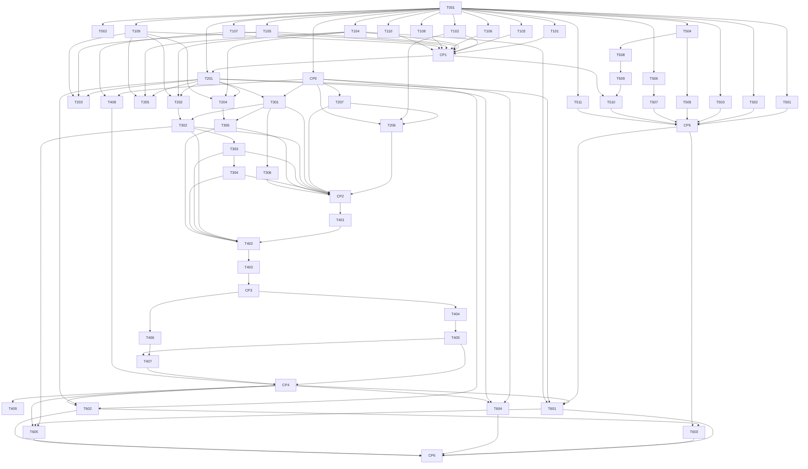

# HomeFund — Catálogo de Tarefas

> Complemento de [`MASTER_PLAN.md`](./MASTER_PLAN.md). Auditoria de origem: [`../audit/AUDIT.md`](../audit/AUDIT.md), [`../audit/ARCHITECTURE.md`](../audit/ARCHITECTURE.md), [`../audit/IMPROVEMENTS.md`](../audit/IMPROVEMENTS.md).
>
> Os vereditos da auditoria estão fechados em `MASTER_PLAN.md` §2. **Não re-auditar.** Se um detalhe faltar, escrever no PR "o executor confirma com grep …" e confirmar no código antes de agir.

## Regras para executores

1. **1 tarefa = 1 branch = 1 PR.** Branch `tNNN-descricao-curta`; commits começam por `TNNN:`. Não misturar tarefas.
2. **Ler os guias do Next antes de tocar em APIs do Next.** Correr `npm ci` (T001) e ler `node_modules/next/dist/docs/` (`AGENTS.md`: *"This is NOT the Next.js you know"*). Respeitar avisos de deprecação. Antes de escrever o código, citar no PR o guia lido.
3. **Nunca aplicar SQL, nunca fazer deploy, nunca alterar segredos.** O agente escreve os ficheiros; um humano aplica-os num checkpoint.
4. **SQL novo:** `supabase/sql/NN_nome.sql` + `supabase/sql/rollback/NN_nome.sql`, ambos idempotentes (`IF NOT EXISTS`, `CREATE OR REPLACE`, `DROP … IF EXISTS`). Numeração fixa: 15 = T207, 16 = T301, 17 = T302, 18 = T303, 19 = T304, 20 = T305, 21 = T401, 22 = T404, 23 = T406, 24 = T408, 25 = T602, 26 = T604, 27 = T409.
5. **Toda a tarefa SQL depende de CP0** e é aplicada por um humano no checkpoint seguinte. Ordem de deploy: **SQL primeiro, código depois**. Um PR de código que dependa de SQL só é integrado/implantado depois de o humano confirmar que o SQL foi aplicado.
6. **Dependências de runtime:** não adicionar nenhuma além de `zod` (T201). Sem bibliotecas de CSV, de UI, de rate limiting, etc.
7. **Testes:** `src/**/*.test.ts` com `node:test` + `tsx`. A lógica de decisão vai para funções puras testáveis.
8. **Verificações obrigatórias antes do PR:** `npm run lint`, `npm run typecheck`, `npm test`, `npm run build` (o `build` usa `--webpack`). O PR indica o resultado de cada um.
9. **Rotas finas:** lógica nova em `src/server/<domínio>/*.ts` com `import "server-only"`. Não criar abstrações genéricas (`authorize()` genérico foi rejeitado).
10. **Não inventar.** Caminhos, nomes de colunas e números de linha dados aqui foram verificados no commit `9543949`; os números de linha podem ter derivado após tarefas anteriores: usar `grep -n` para os reencontrar.
11. **Texto de UI em PT-PT.** Mensagens de validação escritas à mão são seguras de expor; mensagens do Postgres nunca.
12. **Âmbito:** o que estiver em "Fora de âmbito" não se faz, mesmo que pareça óbvio. Registar no PR como sugestão.
13. Um checkpoint (CPx) é uma entrada própria: é executado por humanos; os agentes só preparam os materiais (queries, checklists, scripts).

### Legenda

- **Prioridade:** P0 = risco de segurança/dados, fazer primeiro; P1 = valor alto; P2 = valor médio/oportunístico.
- **Tamanho:** S = ≤ 1 dia, poucos ficheiros; M = 1–3 dias, vários ficheiros ou lógica SQL.
- **VP** (verificações padrão) = `npm run lint`, `npm run typecheck`, `npm test`, `npm run build` verdes.

---

## Tabela-índice

| ID | Título | Fase | Prioridade | Dependências | Tam. |
|---|---|---|---|---|---|
| T001 | Bootstrap: `npm ci`, `.env.example`, scripts `typecheck`/`test` | 0 | P0 | — | S |
| T002 | CI GitHub Actions | 0 | P1 | T001 | S |
| CP0 | Checkpoint: inventário da BD real | 0 | P0 | T001 | S |
| T101 | Atualizar `next`/`eslint-config-next` e `npm audit fix` | 1 | P0 | T001 | S |
| T102 | `kind` só a partir de `app_metadata` | 1 | P0 | T001 | S |
| T103 | Isolamento de metas por família (N-01) | 1 | P0 | T001 | S |
| T104 | `stripReservedTags` no input | 1 | P0 | T001 | S |
| T105 | Autorização de contas (`authz-policy.ts`) | 1 | P0 | T001 | M |
| T106 | `GET` de recorrências só lê | 1 | P1 | T001 | S |
| T107 | Remover código morto | 1 | P1 | T001 | S |
| T108 | Headers de segurança e CSP Report-Only | 1 | P1 | T001 | S |
| T109 | *Error mapper* central | 1 | P1 | T001 | M |
| T110 | `recurring-runner` exige `x-cron-secret` | 1 | P0 | T001 | S |
| CP1 | Checkpoint: revisão e smoke test da Fase 1 | 1 | P0 | T101–T110 | S |
| T201 | `zod` + `src/lib/validation/` | 2 | P1 | T001, CP1 | S |
| T202 | Validação: rotas de transações | 2 | P1 | T201, T104, T109 | M |
| T203 | Validação: contas e categorias | 2 | P1 | T201, T105, T109 | M |
| T204 | Validação: metas, empréstimos, pagamentos | 2 | P1 | T201, T104, T109 | M |
| T205 | Validação: recorrências, famílias, membros | 2 | P1 | T201, T104, T109 | M |
| T206 | `kind` só de `family_members` | 2 | P1 | T102, T207, CP0 | S |
| T207 | SQL 15: backfill `kind`, unicidade, índices | 2 | P1 | CP0 | S |
| T301 | SQL 16: RPC atómicos de saldo | 3 | P0 | CP0, T201 | M |
| T302 | SQL 17: `create_transaction_v1` | 3 | P0 | T301, T202, CP0 | M |
| T303 | SQL 18: `delete_transaction_v1` | 3 | P0 | T302 | M |
| T304 | SQL 19: `update_transaction_v1` | 3 | P0 | T303 | M |
| T305 | SQL 20: pagamentos de empréstimo atómicos | 3 | P1 | T301, T204, CP0 | M |
| T306 | Script de concorrência de saldos | 3 | P1 | T301 | S |
| CP2 | Checkpoint: integridade financeira em produção | 3 | P0 | T206, T207, T301–T306 | M |
| T401 | SQL 21: colunas de metadados + backfill | 4 | P1 | CP2 | M |
| T402 | Escrita dupla (colunas + tags) | 4 | P1 | T401, T302–T305 | M |
| T403 | Leituras por colunas com *fallback* | 4 | P1 | T402 | M |
| CP3 | Checkpoint: cobertura do backfill | 4 | P1 | T403 | S |
| T404 | SQL 22: `materialize_recurring_v1` + `recurrence.ts` | 4 | P1 | CP3 | M |
| T405 | Retirar reconciliação do browser e runner Edge | 4 | P1 | T404 | M |
| T406 | SQL 23: legado, passo 1 | 4 | P2 | CP3, CP0 | S |
| T407 | Código: deixar de escrever o legado | 4 | P2 | T406, T405 | M |
| T408 | SQL 24: RLS deny-all | 4 | P1 | CP0, T107 | S |
| CP4 | Checkpoint: estabilização (2 semanas) | 4 | P1 | T405, T407, T408 | S |
| T409 | SQL 27: `DROP` do legado (opcional) | 4 | P2 | CP4 | S |
| T501 | `error.tsx`, `global-error.tsx`, `not-found.tsx`, `loading.tsx` | 5 | P1 | T001 | S |
| T502 | `AppDialog` acessível | 5 | P1 | T001 | M |
| T503 | `PrettySelect` como listbox | 5 | P1 | T001 | M |
| T504 | Labels `htmlFor`: auth, navegação, formulários | 5 | P1 | T001 | M |
| T505 | Labels `htmlFor`: páginas restantes | 5 | P2 | T504 | M |
| T506 | PT-PT: layout, auth e navegação | 5 | P2 | T001 | M |
| T507 | PT-PT: páginas e componentes restantes | 5 | P2 | T506 | M |
| T508 | Registo: confirmação de email e palavra-passe | 5 | P1 | T504 | S |
| T509 | Recuperação de palavra-passe | 5 | P1 | T508 | M |
| T510 | `src/proxy.ts`: sessão + redirecionamento | 5 | P1 | T509, CP1 | M |
| T511 | Fontes: `preload:false` | 5 | P2 | T001 | S |
| CP5 | Checkpoint: revisão visual e a11y | 5 | P1 | T501–T511 | S |
| T601 | Exportação CSV de transações | 6 | P2 | T201, T104, CP4, CP5 | M |
| T602 | SQL 25 + API: orçamentos por categoria | 6 | P2 | CP0, T201, CP4 | M |
| T603 | UI de orçamentos + widget no dashboard | 6 | P2 | T602, CP5 | M |
| T604 | SQL 26: `dashboard_totals_v1` | 6 | P2 | CP0, T201, CP4 | M |
| T605 | Importação CSV | 6 | P2 | T302, T601, CP4 | M |
| CP6 | Checkpoint: validação de produto | 6 | P2 | T601–T605 | S |

Nota: T201 depende de CP1 apenas por ordem de merge (evitar conflitos nos mesmos ficheiros de rotas que a Fase 1 altera); não há dependência técnica.

---

## Grafo de dependências



---

# Fase 0 — Preparação

### T001 — Bootstrap: `npm ci`, `.env.example`, scripts `typecheck`/`test`
- **Fase / Prioridade / Tamanho:** Fase 0 · P0 · S
- **Achado(s):** F-18, F-21 (e pré-requisito de `AGENTS.md`)
- **Objetivo:** Um clone novo executa `npm ci`, `npm run lint`, `npm run typecheck`, `npm test` e `npm run build` sem passos ocultos, e os guias do Next ficam disponíveis em `node_modules/next/dist/docs/`.
- **Dependências:** nenhuma.
- **Ficheiros prováveis:** `package.json`, `.env.example` (novo), `README.md` (secção de arranque), `.gitignore` (confirmar que `.env*` está ignorado, mas `.env.example` não).
- **Alterações:**
  1. Correr `npm ci` e confirmar que existe `node_modules/next/dist/docs/`. Listar os guias relevantes no PR (pelo menos o de `proxy` — `16-proxy.md` — e os de Route Handlers e `error.tsx`).
  2. Em `package.json`, garantir os scripts: `"typecheck": "tsc --noEmit"` e `"test": "tsx --test \"src/**/*.test.ts\""` (o glob **entre aspas**, para não depender da expansão do *shell*). O executor confirma com `grep -n '"test"\|"typecheck"\|"lint"\|"build"' package.json` o estado atual antes de alterar e mantém o `build` com `--webpack`.
  3. Criar `.env.example` com os nomes (sem valores) das variáveis que o código lê. O executor confirma com `grep -rn "process.env\." src supabase/functions` a lista completa; esperam-se, no mínimo, `NEXT_PUBLIC_SUPABASE_URL`, `NEXT_PUBLIC_SUPABASE_ANON_KEY` e `SUPABASE_SERVICE_ROLE_KEY`. Adicionar `NEXT_ALLOWED_DEV_ORIGINS` (usada em T108) e `CRON_SECRET` (usada em T110) comentadas.
  4. Acrescentar ao `README.md` uma secção "Arranque" (`cp .env.example .env.local`, `npm ci`, `npm run dev`) e "Verificações" com os 4 comandos.
- **Fora de âmbito:** atualizar dependências (T101); criar CI (T002); alterar código aplicacional.
- **Critérios de aceitação:**
  - `npm ci && npm run lint && npm run typecheck && npm test && npm run build` passam num clone limpo (o `build` pode usar variáveis falsas, ver T002).
  - `.env.example` existe, sem segredos.
  - `node_modules/next/dist/docs/` existe e o PR lista os guias.
- **Testes:** nenhum novo. Verificar que `npm test` executa os testes existentes em `src/lib/*.test.ts` (n.º de testes no PR).
- **Riscos e rollback:** risco mínimo. Reverter com `git revert`.

### T002 — CI GitHub Actions
- **Fase / Prioridade / Tamanho:** Fase 0 · P1 · S
- **Achado(s):** F-18, F-06
- **Objetivo:** Cada PR corre lint, typecheck, testes, build e `npm audit` em CI, falhando se houver vulnerabilidades altas/críticas de produção.
- **Dependências:** T001.
- **Ficheiros prováveis:** `.github/workflows/ci.yml` (novo).
- **Alterações:**
  1. Criar `.github/workflows/ci.yml` com *trigger* `pull_request` e `push` em `main`.
  2. Passos: `actions/checkout`, `actions/setup-node` (a versão de Node do `engines`/`.nvmrc`, o executor confirma com `grep -n '"engines"' -A3 package.json`; se não existir, usar a LTS atual e documentar), `npm ci`, `npm run lint`, `npm run typecheck`, `npm test`, `npm run build`, `npm audit --omit=dev --audit-level=high`.
  3. No passo de `build`, definir variáveis falsas: `NEXT_PUBLIC_SUPABASE_URL=https://example.supabase.co`, `NEXT_PUBLIC_SUPABASE_ANON_KEY=dummy`, `SUPABASE_SERVICE_ROLE_KEY=dummy`. O executor confirma com grep que o build não faz chamadas de rede a essas URLs.
  4. Passo de `npm audit` com `continue-on-error: false`. Até T101 estar integrado, este passo falha (esperado): marcar o job como "não obrigatório" na descrição do PR, ou integrar T002 depois de T101.
- **Fora de âmbito:** deploy; segredos reais no CI; cache elaborada; testes E2E.
- **Critérios de aceitação:**
  - O workflow corre no PR e todos os passos executam.
  - Com T101 integrado, o job fica verde.
  - Nenhum segredo real no ficheiro.
- **Testes:** abrir PR de teste que quebra deliberadamente o lint e confirmar que o CI falha (descartar depois).
- **Riscos e rollback:** o `build` pode precisar de mais variáveis; ajustar a lista. Reverter com `git revert` (remove o workflow).

### CP0 — Checkpoint: inventário da base de dados real
- **Fase / Prioridade / Tamanho:** Fase 0 · P0 · S (trabalho humano)
- **Achado(s):** F-08, F-09, F-13 (pré-condição de todas as tarefas SQL)
- **Objetivo:** Conhecer o schema real (a BD existente tem `family_members.kind` sem migração no repositório) antes de escrever ou aplicar qualquer SQL.
- **Dependências:** T001. **Bloqueia:** T206, T207, T301–T305, T401, T404, T406, T408, T409, T602, T604.
- **Ficheiros prováveis:** `supabase/schema/live-schema.sql` (gerado pelo humano), issue/PR de CP0.
- **Alterações:** (executadas por um humano; o agente só prepara o PR/issue com este texto)
  1. Correr no SQL Editor, **só de leitura**, e anexar os resultados:
     ```sql
     select table_name, column_name, data_type, is_nullable from information_schema.columns where table_schema='public' order by 1,2;
     select relname, relrowsecurity from pg_class c join pg_namespace n on n.oid=c.relnamespace where nspname='public' and relkind='r';
     select * from pg_policies where schemaname='public';
     select proname, prosecdef from pg_proc p join pg_namespace n on n.oid=p.pronamespace where nspname='public';
     select indexname, indexdef from pg_indexes where schemaname='public';
     select count(*) from family_members where kind is null;
     select family_id, user_id, count(*) from family_members where user_id is not null group by 1,2 having count(*)>1;
     select bank_account_id, substring(description from '\[recurring:[^\]]+\]') m, count(*) from transactions where description like '%[recurring:%' group by 1,2 having count(*)>1;
     select * from cron.job;   -- só se a extensão pg_cron existir
     ```
  2. Confirmar no painel do Supabase: `verify_jwt` e agendamento da função `recurring-runner`.
  3. Gerar o dump: `supabase db dump --schema-only > supabase/schema/live-schema.sql` e submetê-lo por PR.
  4. Registar por escrito: (a) T207: há `kind` nulos? há duplicados (`family_id`,`user_id`)? (b) T406: que colunas legadas existem de facto e com que restrições; (c) T408: lista de políticas a remover; (d) se `pg_cron` está disponível.
- **Fora de âmbito:** qualquer escrita na BD.
- **Critérios de aceitação:**
  - Todos os resultados anexados.
  - Decisões sobre T207, T406 e T408 registadas.
  - Dump no repositório ou dispensa explícita.
- **Testes:** n/a (verificação humana).
- **Riscos e rollback:** nenhum (só leitura). Se `pg_cron` não existir, T405 muda de plano (ver T405).

---

# Fase 1 — Estancar risco (só código da aplicação)

### T101 — Atualizar `next` e `eslint-config-next`; `npm audit fix` sem `--force`
- **Fase / Prioridade / Tamanho:** Fase 1 · P0 · S
- **Achado(s):** F-06
- **Objetivo:** `npm audit --omit=dev --audit-level=high` sem vulnerabilidades críticas; `next` ≥ 16.4.6.
- **Dependências:** T001.
- **Ficheiros prováveis:** `package.json`, `package-lock.json`.
- **Alterações:**
  1. Ler o guia de *upgrade* em `node_modules/next/dist/docs/` e as notas de versão entre 16.2.1 e a versão alvo; registar breaking changes no PR.
  2. `npm install next@^16.4.6 eslint-config-next@<mesma versão major/minor que next>` (o executor confirma a versão publicada com `npm view next version`). Manter o `build` com `--webpack`.
  3. `npm audit fix` **sem** `--force`. Se sobrarem vulnerabilidades que exigem `--force`, listá-las no PR com análise (não aplicar).
  4. Correr VP e fazer smoke test local (`npm run dev`: login, dashboard, criar transação).
- **Fora de âmbito:** subir majors de outras dependências; refactors.
- **Critérios de aceitação:**
  - `npm audit --omit=dev --audit-level=high` sem críticas (idealmente zero altas; as restantes justificadas).
  - VP verdes; smoke test sem regressões.
- **Testes:** os existentes. Smoke manual: login, navegação nas páginas principais.
- **Riscos e rollback:** *breaking changes* do Next. Reverter com `git revert` (repõe `package.json` e `package-lock.json`).

### T102 — `kind` apenas a partir de `app_metadata`
- **Fase / Prioridade / Tamanho:** Fase 1 · P0 · S
- **Achado(s):** F-02
- **Objetivo:** Um utilizador não consegue promover-se a `system`/`owner` alterando o seu `user_metadata` no browser.
- **Dependências:** T001.
- **Ficheiros prováveis:** `src/lib/member-kind.ts` (`getMemberKindFromAuthUser`, linhas ~12-16), `src/app/api/family-members/route.ts` (`createSystemUser`, `updateSystemUser`, linhas ~41-80), `src/lib/member-kind.test.ts` (novo).
- **Alterações:**
  1. `getMemberKindFromAuthUser(user)` passa a ler **apenas** `user.app_metadata?.homefund_member_kind`. Remover qualquer leitura de `user_metadata` para esta decisão. O executor confirma o nome exato da chave com `grep -n "homefund_member_kind" -r src`.
  2. `updateSystemUser`: em vez de escrever `user_metadata.homefund_member_kind`, escrever `app_metadata.homefund_member_kind` (via `supabaseAdmin.auth.admin.updateUserById(id, { app_metadata: { …existente, homefund_member_kind: kind } })`, preservando as chaves existentes de `app_metadata`).
  3. `createSystemUser` já escreve `app_metadata` (e `user_metadata`): deixar de escrever o `kind` em `user_metadata` (manter outros campos de apresentação, p. ex. nome).
  4. **Utilizadores existentes:** os `system` criados antes têm `app_metadata` (porque `createSystemUser` já o escreve). O executor confirma com grep; se algum caminho antigo só escrevia `user_metadata`, documentar no PR a necessidade de um backfill manual (humano) e **não** o fazer.
  5. Extrair a decisão para uma função pura testável `resolveMemberKind(appMetadata: unknown): "owner" | "member" | "system" | null` (ajustar aos valores reais do código).
- **Fora de âmbito:** deixar de usar `getAuthUserKindById` (T206); alterar emails dos utilizadores system (backlog F-14).
- **Critérios de aceitação:**
  - Com `user_metadata.homefund_member_kind = "system"` e `app_metadata` vazio, o resultado **não** é `system`.
  - Com `app_metadata.homefund_member_kind = "system"`, o resultado é `system`.
  - `updateSystemUser` não escreve `user_metadata.homefund_member_kind`.
  - VP verdes.
- **Testes:** `src/lib/member-kind.test.ts`: `user_metadata` forjado ignorado; `app_metadata` respeitado; valores inesperados → `null`/valor por omissão. Smoke: criar/editar um utilizador system na UI e confirmar que continua a funcionar.
- **Riscos e rollback:** utilizadores `system` antigos sem `app_metadata` perderiam o estatuto (ficam como membros normais). Mitigação: verificar em CP0/CP1. Reverter com `git revert`.

### T103 — Isolamento de metas por família (N-01)
- **Fase / Prioridade / Tamanho:** Fase 1 · P0 · S
- **Achado(s):** N-01
- **Objetivo:** PATCH e DELETE de transações com tag `[goal:<uuid>]` de uma meta de **outra família** respondem 404 "Goal not found." e nunca alteram essa meta.
- **Dependências:** T001.
- **Ficheiros prováveis:** `src/app/api/transactions/route.ts` (`getGoal` ~l.278, ramo de meta do PATCH ~l.963-971, ramo de meta do DELETE ~l.1515-1554), `src/lib/goal-scope.ts` (novo), `src/lib/goal-scope.test.ts` (novo).
- **Alterações:**
  1. Criar `src/lib/goal-scope.ts` com a função pura:
     ```ts
     export function goalBelongsToFamily(
       goal: { bank_account_id: string | null } | null,
       accountFamilyId: string | null | undefined,
       familyId: string,
     ): boolean
     ```
     Devolve `true` só se `goal` existe, `accountFamilyId` existe e é igual a `familyId`.
  2. Alterar `getGoal(goalId: string, familyId: string)` em `transactions/route.ts`: carregar a meta e a respetiva conta (`goals.bank_account_id → bank_accounts.family_id`, por *join* ou segunda consulta) e devolver `null` se `!goalBelongsToFamily(...)`. O executor confirma com `grep -n "getGoal(" src/app/api/transactions/route.ts` todos os pontos de chamada e atualiza-os todos (PATCH l.~971, DELETE l.~1524 e quaisquer outros).
  3. Nos dois ramos, se `getGoal` devolver `null`, responder **404 `{ error: "Goal not found." }`** antes de qualquer escrita (e antes de reverter saldos).
  4. Confirmar que as transferências (verificação em l.~1573) não regridem.
  5. (Mitigação adicional, completada em T104) Não confiar em tags vindas do input.
- **Fora de âmbito:** `stripReservedTags` (T104); RPC de metas; mudar o modelo de dados de metas.
- **Critérios de aceitação:**
  - Um PATCH/DELETE com tag de meta de outra família → 404, sem alteração de `current_amount` da meta nem de saldos.
  - Um PATCH/DELETE com meta da própria família funciona como antes.
  - Não existe chamada a `getGoal` sem `familyId`.
  - VP verdes.
- **Testes:** `src/lib/goal-scope.test.ts` (mesma família, outra família, meta inexistente, conta sem família). Smoke manual (CP1): com 2 famílias de teste, PATCH/DELETE com `[goal:<uuid da outra família>]` → 404.
- **Riscos e rollback:** meta cuja conta não tenha `family_id` (dados antigos) passaria a 404. Mitigação: o executor confirma com grep/CP0 se `goals.bank_account_id` pode ser nulo e, se sim, resolve a família por `goals.family_id`/`user_id` conforme o schema real. Reverter com `git revert`.

### T104 — `stripReservedTags` no input do utilizador
- **Fase / Prioridade / Tamanho:** Fase 1 · P0 · S
- **Achado(s):** F-07 (junta-se a N-01)
- **Objetivo:** Texto vindo do utilizador nunca contém tags reservadas do sistema; o servidor só adiciona as suas próprias tags depois.
- **Dependências:** T001.
- **Ficheiros prováveis:** `src/lib/reserved-tags.ts` (novo), `src/lib/reserved-tags.test.ts` (novo), `src/app/api/transactions/route.ts` (POST descrição ~l.674, tags de membros ~l.713; PATCH), `src/app/api/recurring-transactions/route.ts`, `src/app/api/loan-payments/route.ts`, `src/app/api/goals/route.ts`.
- **Alterações:**
  1. Criar `src/lib/reserved-tags.ts`:
     ```ts
     const RESERVED_TAG = /\[(goal|goal-move|transfer|recurring|loan|members):[^\]]*\]/gi;
     export function stripReservedTags(text: string | null | undefined): string
     ```
     Remove todas as ocorrências, faz `trim` e colapsa espaços duplos resultantes.
  2. Aplicar `stripReservedTags` ao campo de descrição (e a quaisquer campos de texto livre que acabem em `description`) **antes** de o servidor adicionar as suas tags (`[members:…]`, `[transfer:…]`, `[goal:…]`, `[loan:…]`, `[recurring:…]`) em: `transactions` POST e PATCH, `recurring-transactions` POST/PUT, `loan-payments` POST (descrição/nota), `goals` (nomes/notas que sejam copiadas para descrições). O executor confirma com `grep -n "description" src/app/api/*/route.ts` os pontos de entrada.
  3. Cuidado: o PATCH recebe, possivelmente, a descrição **com** as tags do servidor (o cliente reenvia o texto lido). Verificar com grep como o cliente envia; se o cliente reenvia tags, o PATCH deve descartar as tags do input e **reconstruir** as tags a partir do registo existente na BD, nunca do input. Documentar a decisão no PR.
  4. Garantir que as funções existentes `strip*` (usadas para mostrar descrições) continuam a funcionar.
- **Fora de âmbito:** migrar tags para colunas (Fase 4); validação `zod` (T202+).
- **Critérios de aceitação:**
  - Uma descrição enviada com `[goal:<uuid>]`, `[goal-move:allocate]`, `[transfer:…]`, `[recurring:…]`, `[loan:…]` ou `[members:…]` é gravada sem essas tags (salvo as que o servidor adiciona por si).
  - Descrições normais (incluindo parênteses retos legítimos, p. ex. `[2024] renda`) ficam intactas.
  - VP verdes.
- **Testes:** `src/lib/reserved-tags.test.ts`: casos reais (`"Supermercado"`, `"[2024] Seguro"`) e injetados (`"x [goal:123e4567-…]"`, maiúsculas `[GOAL:…]`, múltiplas tags, tag sem fechar). Smoke: criar transação com descrição contendo uma tag e verificar que não afeta a meta.
- **Riscos e rollback:** o PATCH pode, sem querer, apagar tags legítimas do registo existente se a reconstrução falhar; testar edição de transferência, de movimento de meta e de transação de empréstimo. Reverter com `git revert`.

### T105 — Autorização de contas (`authz-policy.ts`)
- **Fase / Prioridade / Tamanho:** Fase 1 · P0 · M
- **Achado(s):** F-01
- **Objetivo:** Só *owners* da conta apagam contas ou alteram saldos; renomear exige acesso à conta; a UI esconde ações não permitidas.
- **Dependências:** T001.
- **Ficheiros prováveis:** `src/lib/authz-policy.ts` (novo), `src/lib/authz-policy.test.ts` (novo), `src/app/api/bank-accounts/route.ts` (PATCH ~l.161-330; verificação de membro ~l.196; DELETE ~l.354-383), `src/lib/api-auth.ts` (`ensureAccountAccess`, `ensureAccountOwner`), `src/app/accounts/page.tsx` (ações editar/ajustar saldo/apagar; recebe `owner_user_ids` por conta).
- **Alterações:**
  1. Criar `src/lib/authz-policy.ts` com funções puras:
     ```ts
     export type AccountPolicyInput = {
       familyRole: "owner" | "member";
       accountOwnerIds: string[];
       accountVisibleIds: string[];
       userId: string;
       kind: "owner" | "member" | "system" | null;
     };
     export function canDeleteAccount(i: AccountPolicyInput): boolean;
     export function canEditAccountBalance(i: AccountPolicyInput): boolean;
     export function canRenameAccount(i: AccountPolicyInput): boolean;
     ```
     Regras: `canDeleteAccount` e `canEditAccountBalance` ⇒ `userId ∈ accountOwnerIds`; `canRenameAccount` ⇒ `userId ∈ accountVisibleIds` (ou owner). `kind === "system"` nunca pode apagar/ajustar saldo. O executor confirma com grep os valores reais de `familyRole`/`kind` em `api-auth.ts`.
  2. `bank-accounts` DELETE: antes de apagar, `ensureAccountOwner(accountId, userId, familyId)` (já existe em `api-auth.ts`); caso contrário 403.
  3. `bank-accounts` PATCH: se o corpo inclui `balance` → `ensureAccountOwner`; se inclui `name` → `ensureAccountAccess`; manter a lógica atual para `hasAccessUpdate` (que já exige owner). 403 com mensagem em PT-PT/EN consistente com a rota.
  4. `src/app/accounts/page.tsx`: usando `owner_user_ids` e o utilizador atual, esconder os botões de apagar e de ajustar saldo para quem não é owner da conta; manter editar nome para quem tem acesso.
  5. Categorias: **não** alterar (decisão de produto em `MASTER_PLAN.md` §8).
- **Fora de âmbito:** validação `zod` das rotas (T203); RPC; permissões de categorias.
- **Critérios de aceitação:**
  - Membro não-owner: DELETE e PATCH de `balance` → 403; PATCH de `name` → 200 se tiver acesso.
  - Owner: tudo como antes.
  - UI não mostra ações proibidas.
  - A matriz de testes da política passa.
  - VP verdes.
- **Testes:** `src/lib/authz-policy.test.ts`: matriz owner / member com visibilidade / member sem visibilidade / system × as 3 funções. Smoke: com 2 utilizadores na mesma família, o não-owner tenta apagar a conta e ajustar o saldo (403) e renomear (OK).
- **Riscos e rollback:** famílias onde ninguém é *owner* da conta (dados antigos) ficam sem poder apagar. Mitigação: o executor confirma com grep como `owner_user_ids` é calculado; se for vazio, tratar o criador da conta/owner da família como owner. Reverter com `git revert`.

### T106 — `GET` de recorrências só lê
- **Fase / Prioridade / Tamanho:** Fase 1 · P1 · S
- **Achado(s):** F-05 (curto prazo)
- **Objetivo:** `GET /api/recurring-transactions` não cria transações nem apaga duplicados; só devolve dados.
- **Dependências:** T001.
- **Ficheiros prováveis:** `src/app/api/recurring-transactions/route.ts` (GET ~l.537; `cleanupRecurringDuplicates` ~l.300; POST `recalculate` ~l.646-680).
- **Alterações:**
  1. Remover do `GET` as chamadas a materialização/reconciliação e a `cleanupRecurringDuplicates`. O executor confirma com `grep -n "cleanupRecurringDuplicates\|materialize\|reconcile" src/app/api/recurring-transactions/route.ts`.
  2. Manter o POST com `recalculate` **sem alterações** (o `AppState.tsx` continua a chamá-lo até T405).
  3. Confirmar que o GET devolve o mesmo formato de dados.
  4. Notar no PR que, enquanto T405 não estiver feito, as ocorrências em falta só são materializadas pelo `recalculate` chamado pelo browser (comportamento a verificar no smoke).
- **Fora de âmbito:** retirar a reconciliação do `AppState` e o executor SQL (T404/T405); corrigir a deriva de dias (T404).
- **Critérios de aceitação:**
  - Dois `GET` consecutivos não alteram a tabela `transactions` (comparar contagens).
  - O fluxo normal (abrir a app) continua a materializar recorrências via `recalculate`.
  - VP verdes.
- **Testes:** smoke manual: contar transações, chamar o GET, recontar. Teste unitário não aplicável (rota); se existir função pura extraída, testá-la.
- **Riscos e rollback:** se alguma UI dependia de o GET materializar, deixa de mostrar ocorrências novas até `recalculate` correr. Mitigação: verificar o `AppState`. Reverter com `git revert`.

### T107 — Remover código morto
- **Fase / Prioridade / Tamanho:** Fase 1 · P1 · S
- **Achado(s):** F-03 (rebaixado), F-15 (parte)
- **Objetivo:** Eliminar o código sem importações que contém os únicos `supabaseBrowser().from(...)`, preparando a RLS deny-all (T408).
- **Dependências:** T001.
- **Ficheiros prováveis:** (a remover) `src/app/actions/accounts.ts`, `src/app/actions/families.ts`, `src/components/TransactionForm.tsx`, `AccountCreateForm.tsx`, `AccountInviteForm.tsx`, `LoanForm.tsx`, `GoalForm.tsx`, `LoanCard.tsx`, `GoalCard.tsx` (todos em `src/components/`), `supabase/functions/create-transaction/`.
- **Alterações:**
  1. **Antes de apagar cada ficheiro**, confirmar 0 importações: `grep -rn "<nome-do-módulo>" src` (por exemplo `grep -rn "TransactionForm\|AccountCreateForm\|AccountInviteForm\|LoanForm\|GoalForm\|LoanCard\|GoalCard" src`, e `grep -rn "actions/accounts\|actions/families" src`). Colar o resultado no PR.
  2. **Atenção:** `src/app/families/page.tsx:169` tem uma função **local** `addMember` (não é a *server action*): **não mexer**.
  3. Apagar os ficheiros e a pasta `supabase/functions/create-transaction/`. Se a pasta `src/app/actions/` ficar vazia, removê-la.
  4. Confirmar com `grep -rn "supabaseBrowser()" src` que sobram apenas usos de `auth.*`; listar no PR (pré-condição de T408: nenhum `.from(` nem `.rpc(` no browser).
  5. Registar no PR que a função Edge `create-transaction` pode estar implantada no projeto Supabase: **o humano** deve removê-la do painel (`supabase functions delete create-transaction`) no CP1.
- **Fora de âmbito:** remover `recurring-runner` (T405); alterar a lógica de `supabaseBrowser`.
- **Critérios de aceitação:**
  - Nenhum ficheiro apagado era importado (prova no PR).
  - `grep -rn "supabaseBrowser().from\|supabaseBrowser()\.rpc" src` sem resultados.
  - VP verdes (o `build` prova que nada dependia deles).
- **Testes:** o `build` e o `typecheck` são a prova. Smoke: abrir contas, metas, empréstimos, famílias.
- **Riscos e rollback:** referência dinâmica escondida (improvável). Reverter com `git revert`.

### T108 — Headers de segurança e CSP Report-Only
- **Fase / Prioridade / Tamanho:** Fase 1 · P1 · S
- **Achado(s):** F-17
- **Objetivo:** Respostas com headers de segurança e CSP em modo *report-only*; `allowedDevOrigins` configurável por ambiente.
- **Dependências:** T001.
- **Ficheiros prováveis:** `next.config.ts`, `.env.example`, `README.md`.
- **Alterações:**
  1. Ler o guia de `headers` (config) em `node_modules/next/dist/docs/` e usar a API da versão instalada (esta versão do Next pode diferir do conhecido).
  2. Em `next.config.ts`, definir `headers()` para `source: "/(.*)"` com:
     - `X-Content-Type-Options: nosniff`
     - `Referrer-Policy: strict-origin-when-cross-origin`
     - `X-Frame-Options: DENY`
     - `Permissions-Policy: camera=(), microphone=(), geolocation=()`
     - `Strict-Transport-Security: max-age=31536000; includeSubDomains` **só quando** `process.env.NODE_ENV === "production"`
     - `Content-Security-Policy-Report-Only: default-src 'self'; connect-src 'self' https://*.supabase.co; img-src 'self' data: blob:; style-src 'self' 'unsafe-inline'; script-src 'self' 'unsafe-inline'; frame-ancestors 'none'`
     (`'unsafe-inline'` em `script-src` é necessário por agora devido ao script de tema inline em `src/app/layout.tsx` ~l.118; as fontes `next/font/google` são auto-alojadas pelo Next, o executor confirma com o *build*; se aparecerem origens em falta nas violações, registá-las, não aplicar enforcing.)
  3. `allowedDevOrigins: process.env.NEXT_ALLOWED_DEV_ORIGINS?.split(",").map(s => s.trim()).filter(Boolean)` (o executor confirma o valor atual com `grep -n allowedDevOrigins next.config.ts` e preserva-o como valor por omissão, se existir, documentando).
  4. Documentar `NEXT_ALLOWED_DEV_ORIGINS` no `.env.example`.
- **Fora de âmbito:** CSP *enforcing*; nonces; rate limiting (rejeitado).
- **Critérios de aceitação:**
  - `curl -I` ao servidor local/preview mostra os headers (HSTS só em produção).
  - Nenhuma violação **bloqueante** (CSP é só *report-only*); a consola do browser mostra as violações para análise em CP1.
  - O dev server continua a aceitar as origens configuradas.
  - VP verdes.
- **Testes:** verificação manual com `curl -I`; abrir a app e inspecionar a consola. Não há teste unitário natural.
- **Riscos e rollback:** quebrar *dev* remoto se `allowedDevOrigins` ficar vazio. Mitigação: manter o valor atual por omissão. Reverter com `git revert`.

### T109 — *Error mapper* central
- **Fase / Prioridade / Tamanho:** Fase 1 · P1 · M
- **Achado(s):** F-12 (mensagens de BD expostas), F-22
- **Objetivo:** Nenhuma mensagem do Postgres/Supabase chega ao cliente; os erros ficam registados com `requestId`.
- **Dependências:** T001.
- **Ficheiros prováveis:** `src/lib/http/errors.ts` (novo), `src/lib/http/errors.test.ts` (novo), todas as rotas em `src/app/api/**/route.ts`.
- **Alterações:**
  1. Criar `src/lib/http/errors.ts`:
     ```ts
     export function toErrorResponse(
       error: unknown,
       opts: { status?: number; publicMessage: string; context?: Record<string, unknown> },
     ): Response // NextResponse.json({ error: publicMessage, requestId }, { status })
     ```
     Gera `requestId = crypto.randomUUID()`, faz `console.error({ requestId, context, error })` e devolve `{ error: publicMessage, requestId }` com `status` (por omissão 500).
  2. Substituir, em **todas** as rotas, os padrões que devolvem `error.message` do Supabase/Postgres (o executor confirma com `grep -rn "error.message\|\.message }" src/app/api`). Manter **mensagens de validação escritas à mão** (não vêm da BD).
  3. Mapear códigos conhecidos quando útil: `23505` → 409 "Registo duplicado."; `23503` → 409/400 "Referência inválida."; `P0002` → 404; restantes → 500 genérico "Ocorreu um erro. Tente novamente." (com `requestId`).
  4. O cliente (`src/lib/**` fetchers/SWR) continua a mostrar `error` ao utilizador; opcionalmente mostrar o `requestId`.
  5. Fazer por rota em *commits* separados dentro do mesmo PR para facilitar a revisão.
- **Fora de âmbito:** `zod` (T201+); Sentry/OTel (eliminados); reestruturar rotas.
- **Critérios de aceitação:**
  - `grep` não encontra `error.message` de origem BD a ser devolvido ao cliente.
  - Um erro forçado (p. ex. FK inválida) devolve `{ error, requestId }` genérico e o log contém o detalhe.
  - VP verdes.
- **Testes:** `src/lib/http/errors.test.ts` (forma da resposta, `requestId` único, mapeamento de códigos). Smoke: provocar um erro 500 e ver a mensagem genérica.
- **Riscos e rollback:** mensagens de erro que a UI mostrava passam a ser genéricas (UX). Reverter com `git revert`.

### T110 — `recurring-runner` exige `x-cron-secret`
- **Fase / Prioridade / Tamanho:** Fase 1 · P0 · S
- **Achado(s):** F-15
- **Objetivo:** Só chamadores com o segredo correto executam o *runner* de recorrências.
- **Dependências:** T001.
- **Ficheiros prováveis:** `supabase/functions/recurring-runner/index.ts`, `README.md`.
- **Alterações:**
  1. No início do handler: `const expected = Deno.env.get("CRON_SECRET"); if (!expected || req.headers.get("x-cron-secret") !== expected) return new Response("Unauthorized", { status: 401 });` (falha fechada: sem segredo configurado, 401).
  2. Usar comparação de tempo constante se disponível (o executor confirma uma abordagem simples; um XOR sobre bytes é suficiente).
  3. Documentar no `README.md`: `supabase secrets set CRON_SECRET=<valor longo aleatório>` (**ação humana**) e que o agendamento (cron externo) deve enviar o header `x-cron-secret`.
  4. Não alterar a lógica de recorrências do runner (será retirado em T405).
- **Fora de âmbito:** corrigir a deriva de dias no runner; remoção do runner (T405).
- **Critérios de aceitação:**
  - Sem header ou com valor errado → 401; com o valor certo → comportamento atual.
  - Documentação do segredo no README.
  - VP verdes (a função Edge não entra no build do Next; revisar o código manualmente).
- **Testes:** teste manual com `curl` contra o runner implantado (humano, CP1). Se a lógica de comparação for extraída para função pura, testá-la.
- **Riscos e rollback:** se o agendamento atual não enviar o header, o runner deixa de correr após o deploy. Mitigação: o humano configura o segredo **e** o agendador antes do deploy (CP1). Reverter com `git revert` + redeploy.

### CP1 — Checkpoint: revisão e smoke test da Fase 1
- **Fase / Prioridade / Tamanho:** Fase 1 · P0 · S (trabalho humano)
- **Achado(s):** F-01, F-02, F-06, F-07, F-15, N-01
- **Objetivo:** Confirmar que a contenção de risco está em produção/preview sem regressões e fixar as decisões de produto.
- **Dependências:** T101, T102, T103, T104, T105, T106, T107, T108, T109, T110.
- **Ficheiros prováveis:** descrição do PR/issue de CP1.
- **Alterações:** (lista de verificação humana)
  1. `npm audit --omit=dev --audit-level=high` sem críticas.
  2. Smoke test em *preview*: login; criar/editar/apagar transação; transferência; mover dinheiro para uma meta; com 2 famílias de teste, PATCH/DELETE com `[goal:<uuid alheio>]` → 404; membro não-owner não apaga conta nem altera saldo; `GET /api/recurring-transactions` não cria transações (comparar contagens).
  3. Humano: `supabase secrets set CRON_SECRET=…`, configurar o agendador com o header, remover `create-transaction` do painel.
  4. Rever violações da CSP Report-Only numa sessão de uso real.
  5. Confirmar (ou aceitar por omissão) as decisões de `MASTER_PLAN.md` §8: categorias, idioma, saldo negativo, fuso horário, quem edita orçamentos.
- **Fora de âmbito:** aplicar SQL.
- **Critérios de aceitação:**
  - Smoke test sem regressões; decisões registadas; `CRON_SECRET` configurado ou runner desativado.
- **Testes:** os da lista de verificação.
- **Riscos e rollback:** se uma tarefa regride, `git revert` do PR respetivo.

---

# Fase 2 — Fundações

### T201 — `zod` + `src/lib/validation/` (schemas partilhados)
- **Fase / Prioridade / Tamanho:** Fase 2 · P1 · S
- **Achado(s):** F-12
- **Objetivo:** Existe uma biblioteca de validação partilhada (única dependência nova de runtime: `zod`) com os blocos de construção usados pelas tarefas T202–T205.
- **Dependências:** T001 (e CP1 apenas por ordem de merge).
- **Ficheiros prováveis:** `package.json`, `package-lock.json`, `src/lib/validation/common.ts`, `src/lib/validation/parse.ts`, `src/lib/validation/common.test.ts`.
- **Alterações:**
  1. `npm install zod`. O executor confirma a versão com `npm view zod version`, lê a documentação da versão instalada (a API difere entre majors) e fixa a versão no PR. Não instalar mais nenhum pacote.
  2. `src/lib/validation/common.ts` com schemas reutilizáveis (nomes sugeridos):
     - `uuidSchema` (`z.string().uuid()`).
     - `moneySchema`: número finito, `> 0`, máx. 2 casas decimais, teto sensato (p. ex. `≤ 1_000_000_000`). Aceitar string numérica? O executor confirma com grep como o cliente envia montantes (`asNumber` em `api-auth.ts`); se vierem como string, usar *coerce* explícito e rejeitar `NaN`/`Infinity`.
     - `signedMoneySchema` (para ajustes de saldo, que podem ser negativos ou zero) — finito, 2 casas decimais.
     - `isoDateSchema`: `YYYY-MM-DD` **e** data de calendário válida (rejeitar `2025-02-30`).
     - `shortTextSchema(max)`: `trim`, comprimento máximo (descrição 500, nomes 120, notas 1000).
     - `optionalText`, `nullableUuid`.
  3. `src/lib/validation/parse.ts`:
     ```ts
     export async function parseJsonBody<T extends z.ZodTypeAny>(
       req: Request, schema: T,
     ): Promise<{ ok: true; data: z.infer<T> } | { ok: false; response: Response }>
     export function parseQuery<T extends z.ZodTypeAny>(url: URL, schema: T): ...
     ```
     Em caso de erro devolve `Response` 400 com `{ error: "<mensagem curta em PT-PT>", fields: [{ path, message }] }` (mensagens escritas à mão a partir dos *issues*, nunca dados da BD). Corpo JSON inválido → 400.
  4. Testes unitários dos schemas.
- **Fora de âmbito:** aplicar os schemas às rotas (T202–T205).
- **Critérios de aceitação:**
  - `zod` é a única dependência nova.
  - `moneySchema` rejeita `0`, negativos, `NaN`, `Infinity`, 3 casas decimais; `isoDateSchema` rejeita `2025-02-30` e `2025-13-01`.
  - VP verdes.
- **Testes:** `src/lib/validation/common.test.ts` com os casos acima mais UUID inválido e texto demasiado longo.
- **Riscos e rollback:** diferenças de API entre versões do `zod`. `git revert` remove a dependência (nada usa ainda).

### T202 — Validação: rotas de transações
- **Fase / Prioridade / Tamanho:** Fase 2 · P1 · M
- **Achado(s):** F-12, F-07
- **Objetivo:** `POST/PATCH/DELETE /api/transactions` validam o input com `zod` e rejeitam o inválido com 400 antes de tocar na BD.
- **Dependências:** T201, T104, T109.
- **Ficheiros prováveis:** `src/lib/validation/transactions.ts` (novo) + teste, `src/app/api/transactions/route.ts`, outras rotas de transações se existirem (o executor confirma com `ls src/app/api/transactions*` e `grep -rn "from(\"transactions\")" src/app/api`).
- **Alterações:**
  1. O executor confirma com `grep -n "body\.\|searchParams" src/app/api/transactions/route.ts` todos os campos aceites em POST (normal, transferência, empréstimo, movimento de meta), PATCH e DELETE, e reflete-os em schemas:
     - `createTransactionSchema` (união discriminada por tipo de operação: `normal` | `transfer` | `loan`/`goal-move` conforme os campos reais).
     - `updateTransactionSchema` (campos opcionais, pelo menos um presente).
     - `deleteTransactionQuerySchema` (`id` UUID).
  2. Regras: `amount` com `moneySchema`; `date` com `isoDateSchema`; ids com `uuidSchema`; `description` com `shortTextSchema(500)` aplicada **depois** de `stripReservedTags` (T104); `type ∈ {income, expense}`; transferência: contas origem e destino distintas.
  3. Substituir o *parsing* manual (`asNumber`, `Number(...)`, `typeof`) por `parseJsonBody(req, schema)` no início de cada handler; manter exatamente o mesmo formato de resposta de sucesso.
  4. Preservar o comportamento atual para campos opcionais (não tornar obrigatório o que hoje é opcional); o executor compara casos com o cliente (`grep -rn "/api/transactions" src`).
- **Fora de âmbito:** mudar a lógica de saldos (T301+); validar outras rotas.
- **Critérios de aceitação:**
  - Montante 0, negativo, `NaN` ou string não numérica → 400; data inválida → 400; UUID inválido → 400.
  - Todos os fluxos válidos existentes continuam a funcionar (criar, editar, apagar, transferir, mover para meta).
  - VP verdes.
- **Testes:** `src/lib/validation/transactions.test.ts` (casos válidos e inválidos por variante). Smoke: criar transação normal e transferência; tentar montante 0.
- **Riscos e rollback:** validação demasiado estrita quebra um fluxo da UI; mitigar com o smoke test de todos os formulários. `git revert`.

### T203 — Validação: contas e categorias
- **Fase / Prioridade / Tamanho:** Fase 2 · P1 · M
- **Achado(s):** F-12
- **Objetivo:** As mutações de `bank-accounts` e `categories` validam o input com `zod`.
- **Dependências:** T201, T105, T109.
- **Ficheiros prováveis:** `src/lib/validation/accounts.ts`, `src/lib/validation/categories.ts` (novos) + testes, `src/app/api/bank-accounts/route.ts`, `src/app/api/categories/route.ts` (o executor confirma o caminho com `ls src/app/api`).
- **Alterações:**
  1. Schemas: criar conta (`name` 1–120, tipo conforme o enum real — o executor confirma com `grep -n "type" src/app/api/bank-accounts/route.ts`, `balance` inicial com `signedMoneySchema`, `owner_user_ids`/`visible_user_ids` como arrays de UUID sem duplicados); PATCH (campos opcionais; manter as regras de T105 intactas: a autorização corre **depois** da validação estrutural e **antes** de qualquer escrita); categorias (`name` 1–60, `color` com regex `#RRGGBB` se for o formato atual, `type`).
  2. Aplicar `parseJsonBody` nos handlers; manter os formatos de resposta.
  3. Não tocar na semântica de autorização introduzida em T105.
- **Fora de âmbito:** decisão de DELETE de categorias só por owner (decisão de produto, CP1); alterar modelo de dados.
- **Critérios de aceitação:**
  - Nome vazio/demasiado longo, cor inválida, UUID inválido → 400.
  - Autorização de T105 intacta (testes de T105 passam).
  - VP verdes.
- **Testes:** testes dos schemas; smoke: criar/editar conta e categoria.
- **Riscos e rollback:** cores/tipos existentes que não cumprem o novo schema. O executor valida contra dados reais (`select distinct color from categories` pelo humano) ou usa o formato mais permissivo observado. `git revert`.

### T204 — Validação: metas, empréstimos e pagamentos
- **Fase / Prioridade / Tamanho:** Fase 2 · P1 · M
- **Achado(s):** F-12
- **Objetivo:** As mutações de `goals`, `loans` e `loan-payments` validam o input com `zod`.
- **Dependências:** T201, T104, T109.
- **Ficheiros prováveis:** `src/lib/validation/goals.ts`, `loans.ts`, `loan-payments.ts` (novos) + testes, `src/app/api/goals/route.ts`, `src/app/api/loans/route.ts`, `src/app/api/loan-payments/route.ts`.
- **Alterações:**
  1. Schemas por rota, refletindo os campos reais (o executor confirma com `grep -n "body\." src/app/api/{goals,loans,loan-payments}/route.ts`): metas (`name`, `target_amount` com `moneySchema`, `deadline` opcional `isoDateSchema`, conta associada UUID; movimentos `allocate|release|spend` com `amount` e meta UUID); empréstimos (`principal`, taxa, datas, `remaining_amount` coerente); pagamentos (`loan_id`, `account_id`, `amount` > 0, `date`).
  2. Aplicar `parseJsonBody`; `stripReservedTags` (T104) continua a correr antes de gravar texto.
  3. Manter a chamada aos RPC de `14_atomic_goal_movements.sql` (padrão existente em `goals/route.ts`) inalterada.
  4. **Não** acrescentar a regra `amount ≤ remaining` (é de T305).
- **Fora de âmbito:** atomicidade dos pagamentos (T305).
- **Critérios de aceitação:** montantes inválidos, datas inválidas e UUID inválidos → 400; fluxos válidos inalterados; VP verdes.
- **Testes:** testes dos schemas; smoke: criar meta, mover para meta, criar empréstimo, registar pagamento.
- **Riscos e rollback:** campos opcionais mal tipados quebram formulários. `git revert`.

### T205 — Validação: recorrências, famílias e membros
- **Fase / Prioridade / Tamanho:** Fase 2 · P1 · M
- **Achado(s):** F-12, F-14 (parcial: validar email e `kind`)
- **Objetivo:** As mutações de `recurring-transactions`, `families` e `family-members` validam o input com `zod`.
- **Dependências:** T201, T104, T109.
- **Ficheiros prováveis:** `src/lib/validation/recurring.ts`, `families.ts`, `family-members.ts` (novos) + testes, `src/app/api/recurring-transactions/route.ts`, `src/app/api/families/route.ts`, `src/app/api/family-members/route.ts`.
- **Alterações:**
  1. Schemas: recorrência (`frequency` com o enum real — o executor confirma com `grep -n "normalizeFrequency" -r src` —, `amount`, `start_date`/`next_execution_date`, `end_date` opcional ≥ início, conta, categoria, tipo); famílias (`name` 1–80); membros (`email` válido, `kind ∈ {owner, member, system}` ou os valores reais, `family_id` UUID; para criação de `system`: nome, e `kind` só aceite se o chamador for owner — a autorização existente mantém-se).
  2. Aplicar `parseJsonBody`.
  3. Manter o formato de resposta e as regras existentes de autorização.
- **Fora de âmbito:** enumeração de emails/convites por token (backlog F-14); alterar `kind` (T102/T206).
- **Critérios de aceitação:** email inválido, `frequency` desconhecida, `end_date` < início → 400; fluxos válidos inalterados; VP verdes.
- **Testes:** testes dos schemas; smoke: criar recorrência, criar família, adicionar membro.
- **Riscos e rollback:** emails reais existentes que o `zod` rejeita (casos raros); usar `z.string().email()` e não reforçar. `git revert`.

### T206 — `kind` apenas de `family_members`
- **Fase / Prioridade / Tamanho:** Fase 2 · P1 · S
- **Achado(s):** F-13
- **Objetivo:** `getAccessibleAccountIds` e `ensureAccountOwner` deixam de chamar `getAuthUserKindById` (que percorre `listUsers`/chamadas admin) e usam `family_members.kind`.
- **Dependências:** T102, T207, CP0. **Atenção:** o código só é implantado depois de o humano aplicar `supabase/sql/15_*.sql` (T207) ou de CP0 mostrar zero `kind` nulos.
- **Ficheiros prováveis:** `src/lib/api-auth.ts` (`getAccessibleAccountIds`, `ensureAccountOwner`), `src/lib/member-kind.ts` (`getAuthUserKindById`, `getAuthUsersByIds`), testes.
- **Alterações:**
  1. O executor confirma com `grep -rn "getAuthUserKindById\|getAuthUsersByIds" src` todos os usos.
  2. Em `getAccessibleAccountIds` e `ensureAccountOwner`, ler `kind` da linha de `family_members` (já carregada ou com um `select kind` adicional) em vez de consultar o Auth.
  3. Tratar `kind` nulo como `"member"` (valor seguro) e registar um `console.warn`.
  4. Remover `getAuthUserKindById` dos caminhos quentes; **manter** `getAuthUsersByIds` se ainda for usado para mostrar nomes/emails (pontos não quentes). Se `getAuthUserKindById` ficar sem usos, apagá-lo.
  5. Se `kind` ainda for decidido por `getMemberKindFromAuthUser(app_metadata)` ao **criar** membros (`family-members/route.ts`), manter; esta tarefa só altera leituras.
- **Fora de âmbito:** eliminar `listUsers` noutras rotas (convites); `profiles` (backlog).
- **Critérios de aceitação:**
  - Nenhuma chamada a `getAuthUserKindById` nos caminhos de autorização.
  - Permissões idênticas às anteriores para owner/member/system (testes de T105 passam).
  - VP verdes.
- **Testes:** testes unitários da decisão de visibilidade com `kind` injetado; smoke: owner vê todas as contas, member só as visíveis, system conforme as regras.
- **Riscos e rollback:** `kind` nulo em linhas antigas → tratado como `member`, o que pode esconder contas a um owner antigo; por isso exige-se CP0/T207 antes de implantar. `git revert`.

### T207 — SQL 15: backfill de `family_members.kind`, unicidade e índices
- **Fase / Prioridade / Tamanho:** Fase 2 · P1 · S
- **Achado(s):** F-08, F-13, F-11 (índices)
- **Objetivo:** `family_members.kind` sem nulos e garantido por schema (migração em falta), unicidade `(family_id, user_id)` e índices de desempenho.
- **Dependências:** CP0 (resultados das queries de `kind` nulo e duplicados). **Ficheiros SQL:** `supabase/sql/15_family_members_kind_indexes.sql` · rollback `supabase/sql/rollback/15_family_members_kind_indexes.sql`. Aplicado por humano antes do deploy de T206 (CP2).
- **Ficheiros prováveis:** os dois SQL acima.
- **Alterações:**
  1. Cabeçalho do ficheiro: aviso "aplicar manualmente após CP0; idempotente".
  2. Garantir a coluna (caso a BD de algum ambiente não a tenha): `alter table public.family_members add column if not exists kind text;`
  3. Backfill: definir `kind` para as linhas nulas. Regra: `'owner'` se `role = 'owner'` (o executor confirma o nome da coluna de papel no `live-schema.sql`), `'member'` caso contrário. Utilizadores `system`: **não inferir**; se CP0 mostrar `system` com `kind` nulo, o humano fornece a lista de `user_id`; o SQL aceita-os apenas por `update … where user_id in (…)` documentado como passo manual comentado.
  4. Restrição de valores (se compatível com CP0): `alter table … add constraint family_members_kind_check check (kind in ('owner','member','system')) not valid;` seguido de `validate constraint` num passo separado.
  5. **Só se CP0 mostrar zero duplicados:** `create unique index if not exists family_members_family_user_uidx on public.family_members (family_id, user_id) where user_id is not null;`. Se houver duplicados, **não** criar o índice; deixar a secção comentada e o humano resolve os duplicados primeiro.
  6. Índices: `create index if not exists transactions_family_date_idx on public.transactions (family_id, date);` e `create index if not exists transactions_bank_account_date_idx on public.transactions (bank_account_id, date);` (o executor confirma que as colunas existem em `live-schema.sql`; se `transactions` não tiver `family_id`, usar apenas o segundo e documentar).
  7. Rollback: `drop index if exists` para os 3 índices, `alter table … drop constraint if exists family_members_kind_check`. O backfill de `kind` **não** se reverte (aditivo).
- **Fora de âmbito:** alterar código; remover colunas.
- **Critérios de aceitação:**
  - Ficheiros revistos, idempotentes (correr duas vezes sem erro, testado pelo humano em staging).
  - Depois de aplicado: `select count(*) from family_members where kind is null` = 0.
  - O PR não contém código de aplicação.
- **Testes:** humano em staging: aplicar duas vezes; executar `explain` de uma consulta `transactions where family_id = … and date between …` e confirmar uso do índice.
- **Riscos e rollback:** o índice único falha se houver duplicados (mitigado por CP0). `create index` em tabelas grandes pode bloquear escritas; usar `concurrently` fora de transação se a tabela for grande (decisão do humano). Rollback: script `rollback/15_…`.

---

# Fase 3 — Integridade financeira

> Padrão comum de T302–T305 (copiar de `supabase/sql/14_atomic_goal_movements.sql`): `security definer`, `set search_path = public`, `FOR UPDATE`, `revoke all … from public, anon, authenticated`, `grant execute … to service_role`. Cada RPC recebe `p_user_id` e `p_family_id`, verifica que o utilizador é membro (`family_members`), que todas as contas pertencem a `p_family_id`, e bloqueia as contas com `FOR UPDATE` **por ordem de `id`** (evita deadlocks em transferências). Escreve também as colunas legadas enquanto T407 não estiver feito. Erros com `errcode` próprio (`HF400`, `HF403`, `HF404`, `HF409`) mapeados para 400/403/404/409 em TS por `src/server/finance/rpc-errors.ts`. A visibilidade por conta continua a ser verificada em TS **antes** da chamada.

### T301 — SQL 16: RPC atómicos de saldo + `balance.ts`
- **Fase / Prioridade / Tamanho:** Fase 3 · P0 · M
- **Achado(s):** F-04, F-23 (floats absorvidos por `numeric`)
- **Objetivo:** O saldo de contas e o `remaining_amount` de empréstimos passam a ser alterados por `balance = balance + Δ` numa única instrução SQL; os 4 *read-modify-write* em TS desaparecem (quick win contra *lost updates*).
- **Dependências:** CP0, T201. **Ficheiros SQL:** `supabase/sql/16_atomic_balance_deltas.sql` · rollback `supabase/sql/rollback/16_atomic_balance_deltas.sql`.
- **Ficheiros prováveis:** os dois SQL; `src/server/finance/balance.ts` (novo), `src/server/finance/rpc-errors.ts` (novo), testes; `src/app/api/transactions/route.ts` (`applyBalanceDelta` ~l.241, `applyLoanRemainingDelta` ~l.258), `src/app/api/loan-payments/route.ts` (`applyAccountDelta`), `src/app/api/recurring-transactions/route.ts` e `supabase/functions/recurring-runner/index.ts` (equivalentes; o executor confirma com `grep -rn "balance" src/app/api supabase/functions | grep -i "update\|delta"`).
- **Alterações:**
  1. SQL 16 (esboço a manter):
     ```sql
     create or replace function public.apply_account_balance_delta_v1(p_account_id uuid, p_delta numeric)
     returns numeric language plpgsql security definer set search_path = public as $$
     declare v_balance numeric;
     begin
       update public.bank_accounts set balance = coalesce(balance,0) + p_delta
        where id = p_account_id returning balance into v_balance;
       if not found then raise exception 'bank_account_not_found' using errcode = 'P0002'; end if;
       return v_balance;
     end $$;
     revoke all on function public.apply_account_balance_delta_v1(uuid, numeric) from public, anon, authenticated;
     grant execute on function public.apply_account_balance_delta_v1(uuid, numeric) to service_role;
     ```
  2. Função gémea `apply_loan_remaining_delta_v1(p_loan_id uuid, p_delta numeric)` com `remaining_amount = greatest(0, coalesce(remaining_amount,0) + p_delta)`, `P0002` se não existir, mesmos `revoke`/`grant`. Confirmar o nome real da coluna (`remaining_amount`) com `live-schema.sql`/grep.
  3. Rollback: `drop function if exists …(uuid, numeric)` das duas.
  4. TS: `src/server/finance/balance.ts` com `import "server-only"`:
     ```ts
     export async function applyAccountBalanceDelta(accountId: string, delta: number): Promise<number>
     export async function applyLoanRemainingDelta(loanId: string, delta: number): Promise<number>
     ```
     Chamam `supabaseAdmin.rpc("apply_account_balance_delta_v1", { p_account_id, p_delta })`; um erro `P0002` lança um erro tipado que as rotas mapeiam para 404.
  5. Substituir `applyBalanceDelta` e `applyLoanRemainingDelta` (transactions), `applyAccountDelta` (loan-payments) e os equivalentes em recorrências/runner pelos wrappers. O executor confirma **todos** os pontos com `grep -rn "applyBalanceDelta\|applyAccountDelta\|applyLoanRemainingDelta" src` (15+ chamadas) e apaga as funções antigas.
  6. **Ordem de deploy: SQL primeiro (humano aplica 16), código depois.** O PR de código só é integrado após a confirmação.
  7. O runner Edge (Deno) não pode importar `server-only`; se mantiver lógica de saldo, chamar o RPC diretamente via `supabase.rpc(...)` (confirmar com grep; será retirado em T405).
- **Fora de âmbito:** atomicidade de operações compostas (T302–T305); alterar a semântica de saldo negativo (permitido).
- **Critérios de aceitação:**
  - `grep -rn "applyBalanceDelta\|applyAccountDelta"` não encontra definições antigas nem *read-modify-write* de saldo (`select balance` seguido de `update balance`).
  - O script de T306 dá saldo final correto.
  - Comportamento funcional idêntico (smoke de CP2).
  - VP verdes.
- **Testes:** testes unitários dos wrappers com *mock* de `supabaseAdmin.rpc` (sucesso, `P0002`, erro genérico). Smoke manual: criar/apagar transação e conferir o saldo.
- **Riscos e rollback:** o RPC não existir quando o código chega → 500 em todas as rotas financeiras (por isso SQL antes). Rollback: `git revert` do PR de código **primeiro**; só depois, se necessário, `rollback/16_…`.

### T302 — SQL 17: `create_transaction_v1`
- **Fase / Prioridade / Tamanho:** Fase 3 · P0 · M
- **Achado(s):** F-04, F-22
- **Objetivo:** Criar transações (normal, transferência, empréstimo) numa única transação SQL atómica; o POST passa a ser uma rota fina.
- **Dependências:** T301, T202, CP0. **Ficheiros SQL:** `supabase/sql/17_create_transaction_v1.sql` · rollback `supabase/sql/rollback/17_create_transaction_v1.sql`.
- **Ficheiros prováveis:** os dois SQL; `src/server/transactions/create.ts` (novo) + teste; `src/app/api/transactions/route.ts` (POST ~l.647; descrição ~l.674; tags de membros ~l.713; `insert` ~l.874-891; delta ~l.898).
- **Alterações:**
  1. O executor lê o POST atual por inteiro e documenta no PR uma lista de comportamentos (normal, transferência, empréstimo, movimento de meta se passar pelo POST) a preservar.
  2. SQL 17: assinatura
     ```sql
     create or replace function public.create_transaction_v1(
       p_user_id uuid, p_family_id uuid, p_payload jsonb
     ) returns jsonb language plpgsql security definer set search_path = public as $$ … $$;
     ```
     `p_payload` inclui `kind` (`'normal'|'transfer'|'loan'`), `bank_account_id`, `to_bank_account_id` (transferência), `type`, `amount`, `date`, `description` (já sem tags reservadas e com as tags do servidor construídas em TS, até T402), `category_id`, `loan_id`, e os campos legados necessários (o executor confirma colunas em `live-schema.sql`).
  3. Corpo: (a) validar que `p_user_id` é membro de `p_family_id` (`select 1 from family_members … ` → `HF403`); (b) bloquear contas envolvidas `FOR UPDATE` por ordem de id e validar `family_id` (`HF404`/`HF403`); (c) inserir a(s) linha(s) de `transactions` (transferência: duas linhas e o registo de `transfers`, conforme o comportamento atual); (d) aplicar `apply_account_balance_delta_v1` às contas; (e) empréstimo: `apply_loan_remaining_delta_v1`; (f) devolver `jsonb` com os ids/linhas criados.
  4. `REVOKE`/`GRANT` conforme o padrão.
  5. `src/server/transactions/create.ts`: `export async function createTransaction(input: CreateTransactionInput, ctx: { userId: string; familyId: string }): Promise<CreatedTransaction>` — verifica visibilidade da conta em TS (`ensureAccountAccess`), constrói o payload, chama `supabaseAdmin.rpc("create_transaction_v1", …)`, mapeia erros com `rpc-errors.ts`.
  6. O POST fica: parse (T202) → `createTransaction` → resposta no formato atual.
  7. Rollback SQL: `drop function if exists public.create_transaction_v1(uuid, uuid, jsonb);`.
- **Fora de âmbito:** PATCH e DELETE (T303, T304); mover metadados para colunas (T401–T403).
- **Critérios de aceitação:**
  - Uma falha a meio (p. ex. conta de outra família) não deixa linhas nem saldos alterados.
  - Criação normal, transferência e de empréstimo dão os mesmos resultados visíveis (transações, saldos, `remaining_amount`) que antes.
  - O ficheiro `route.ts` encolhe (registar nº de linhas antes/depois no PR).
  - VP verdes.
- **Testes:** testes unitários de `create.ts` com `rpc` simulado (mapeamento de erros, construção do payload). Smoke de CP2 (staging): transação normal receita/despesa, transferência, empréstimo, falha forçada.
- **Riscos e rollback:** divergência subtil de comportamento face ao código antigo (tags, campos legados). Mitigar com a lista de comportamentos do passo 1. `git revert` do código; o RPC fica inerte.

### T303 — SQL 18: `delete_transaction_v1`
- **Fase / Prioridade / Tamanho:** Fase 3 · P0 · M
- **Achado(s):** F-04, F-22, N-01 (verificação de família reforçada em SQL)
- **Objetivo:** Apagar transações (normal, transferência, empréstimo, movimento de meta reservado) atomicamente, revertendo saldos e metas.
- **Dependências:** T302. **Ficheiros SQL:** `supabase/sql/18_delete_transaction_v1.sql` · rollback `supabase/sql/rollback/18_delete_transaction_v1.sql`.
- **Ficheiros prováveis:** os dois SQL; `src/server/transactions/delete.ts` (novo) + teste; `src/app/api/transactions/route.ts` (DELETE ~l.1480; ramo de meta ~l.1515-1554; transferência ~l.1556-1610, verificação de família ~l.1573).
- **Alterações:**
  1. SQL 18: `delete_transaction_v1(p_user_id uuid, p_family_id uuid, p_transaction_id uuid) returns jsonb` (`security definer`, `search_path = public`).
  2. Lógica: carregar a transação com `FOR UPDATE`; validar pertença à família (`HF404` se outra família); bloquear a(s) conta(s) por ordem de id; ramos:
     - **Normal:** reverter o efeito no saldo (`apply_account_balance_delta_v1` com o simétrico) e apagar.
     - **Transferência:** localizar a contraparte (pela tag `[transfer:…]` até T403, depois por `transfer_id`), reverter ambos os lados, apagar as duas linhas e o registo `transfers`.
     - **Empréstimo:** reverter saldo e `apply_loan_remaining_delta_v1` com o simétrico.
     - **Movimento de meta reservado** (`[goal:uuid]` + `[goal-move:allocate|release|spend]`): reverter `goals.current_amount` **apenas se a meta pertencer à família** (`goals.bank_account_id → bank_accounts.family_id = p_family_id`; N-01 em SQL), chamando as funções de `14_atomic_goal_movements.sql` (o executor confirma os nomes com `grep -n "create or replace function" supabase/sql/14_atomic_goal_movements.sql`) ou a mesma lógica numa única transação.
  3. `src/server/transactions/delete.ts`: `deleteTransaction(id: string, ctx: { userId; familyId }): Promise<void>`; verifica visibilidade em TS antes do RPC.
  4. O DELETE da rota fica fino (validação → `deleteTransaction` → resposta atual).
  5. Rollback SQL: `drop function if exists public.delete_transaction_v1(uuid, uuid, uuid);`.
- **Fora de âmbito:** PATCH (T304); novas colunas (T401).
- **Critérios de aceitação:**
  - Apagar cada tipo de transação reverte exatamente o que o código antigo revertia (saldos, meta, empréstimo, contraparte da transferência).
  - Apagar uma transação com tag de meta de outra família → 404 e nada alterado.
  - Falha a meio não deixa estado parcial.
  - VP verdes.
- **Testes:** testes unitários de `delete.ts` (mapeamento de erros); smoke de CP2 para os 4 tipos.
- **Riscos e rollback:** transferências antigas com tags irregulares. Mitigar com os casos de CP2. `git revert`.

### T304 — SQL 19: `update_transaction_v1`
- **Fase / Prioridade / Tamanho:** Fase 3 · P0 · M
- **Achado(s):** F-04, F-22
- **Objetivo:** Editar transações (normal e transferência) atomicamente, recalculando saldos de forma correta ao mudar montante, conta, tipo ou data.
- **Dependências:** T303. **Ficheiros SQL:** `supabase/sql/19_update_transaction_v1.sql` · rollback `supabase/sql/rollback/19_update_transaction_v1.sql`.
- **Ficheiros prováveis:** os dois SQL; `src/server/transactions/update.ts` (novo) + teste; `src/app/api/transactions/route.ts` (PATCH ~l.913; ramo de meta ~l.963-…, `getGoal` ~l.971); `docs/implementation/characterization/transactions-patch.md` (opcional, checklist manual).
- **Alterações:**
  1. **Passo 0 (obrigatório, é a tarefa mais arriscada):** antes de escrever SQL, escrever no PR uma **checklist de caracterização** do comportamento atual do PATCH com os casos: mudar montante; mudar conta; mudar tipo (receita↔despesa); mudar data/descrição/categoria; editar transferência (montante, conta origem/destino); editar movimento de meta; editar transação de empréstimo. Para cada caso: estado inicial, ação, saldos esperados. Executar a checklist manualmente **antes** (código antigo) e **depois** (RPC) em staging.
  2. SQL 19: `update_transaction_v1(p_user_id uuid, p_family_id uuid, p_transaction_id uuid, p_patch jsonb) returns jsonb`. Lógica: bloquear a transação e todas as contas envolvidas (antiga e nova) `FOR UPDATE` por ordem de id; reverter o efeito antigo (delta simétrico na conta antiga), aplicar o novo efeito (delta na conta nova), atualizar a linha; para transferências, atualizar também a contraparte e o registo `transfers`.
  3. Os ramos de **meta** e **empréstimo** do PATCH: se a checklist mostrar que o PATCH atual os trata, o RPC tem de os tratar com a mesma regra (incluindo verificação de família da meta, N-01); se for impraticável, **não** migrar esse ramo e deixar o código existente (já corrigido em T103) com nota explícita no PR.
  4. `src/server/transactions/update.ts`: `updateTransaction(id: string, patch: UpdateTransactionInput, ctx: { userId; familyId }): Promise<TransactionRow>`; valida visibilidade em TS (conta antiga **e** nova) antes do RPC.
  5. Rollback SQL: `drop function if exists public.update_transaction_v1(uuid, uuid, uuid, jsonb);`.
- **Fora de âmbito:** mudar o formato do PATCH; novas colunas (T401).
- **Critérios de aceitação:**
  - Todos os casos da checklist dão o mesmo resultado antes/depois (tabela anexada ao PR).
  - Mudar de conta move o efeito de uma conta para a outra sem diferenças de cêntimos.
  - Falha a meio não deixa estado parcial.
  - VP verdes.
- **Testes:** testes unitários de `update.ts` (construção de `p_patch`, mapeamento de erros); checklist manual em staging.
- **Riscos e rollback:** maior risco da fase (regressões de saldo). Mitigação: checklist + staging + gatilho "divergência de saldo". `git revert` do código; o RPC fica inerte.

### T305 — SQL 20: pagamentos de empréstimo atómicos
- **Fase / Prioridade / Tamanho:** Fase 3 · P1 · M
- **Achado(s):** F-10
- **Objetivo:** Registar e apagar pagamentos de empréstimo é atómico e simétrico: o DELETE reverte a transação e o saldo; pagamentos acima do que falta pagar são rejeitados.
- **Dependências:** T301, T204, CP0. **Ficheiros SQL:** `supabase/sql/20_loan_payments_atomic.sql` · rollback `supabase/sql/rollback/20_loan_payments_atomic.sql`.
- **Ficheiros prováveis:** os dois SQL; `src/server/finance/loan-payments.ts` (novo) + teste; `src/app/api/loan-payments/route.ts` (POST ~l.60-190; DELETE ~l.192-254, erros ignorados ~l.246-251).
- **Alterações:**
  1. SQL 20, parte A: `alter table public.loan_payments add column if not exists transaction_id uuid null references public.transactions(id) on delete set null;`
  2. Parte B: `record_loan_payment_v1(p_user_id uuid, p_family_id uuid, p_loan_id uuid, p_account_id uuid, p_amount numeric, p_date date, p_note text) returns jsonb`: bloqueia empréstimo e conta `FOR UPDATE`; valida família; **`p_amount > remaining_amount` → `HF400`** (mensagem `amount_exceeds_remaining`); insere a transação (despesa) se o comportamento atual a cria, insere `loan_payments` com `transaction_id`, aplica `apply_account_balance_delta_v1(-amount)` e `apply_loan_remaining_delta_v1(-amount)`.
  3. Parte C: `delete_loan_payment_v1(p_user_id uuid, p_family_id uuid, p_payment_id uuid) returns jsonb`: se `transaction_id` não é nulo, apaga a transação e reverte o saldo da conta e `remaining_amount`; **pagamentos antigos com `transaction_id` nulo mantêm o comportamento atual** (só apagam o pagamento e revertem o que o código antigo revertia) — documentar no PR.
  4. TS: `recordLoanPayment(input, ctx)` e `deleteLoanPayment(id, ctx)` em `src/server/finance/loan-payments.ts`; as rotas passam a chamá-los; **os erros deixam de ser ignorados** (sem `catch` silencioso).
  5. Rollback SQL: `drop function if exists` das duas funções; **não** remover a coluna `transaction_id` (aditivo).
- **Fora de âmbito:** backfill de `transaction_id` de pagamentos antigos; mudanças à UI de empréstimos.
- **Critérios de aceitação:**
  - Pagamento > `remaining_amount` → 400.
  - Registar e apagar um pagamento novo deixa saldo da conta, `remaining_amount` e transações exatamente como antes do registo.
  - Pagamentos antigos: o DELETE continua a funcionar como antes.
  - Nenhum erro ignorado silenciosamente.
  - VP verdes.
- **Testes:** testes unitários dos wrappers; smoke de CP2: registar, apagar, exceder o remanescente, apagar pagamento antigo.
- **Riscos e rollback:** diferenças entre pagamentos novos e antigos confundem utilizadores; documentado. `git revert` + `rollback/20_…`.

### T306 — Script manual de concorrência de saldos
- **Fase / Prioridade / Tamanho:** Fase 3 · P1 · S
- **Achado(s):** F-04
- **Objetivo:** Um script manual prova que 20 deltas concorrentes resultam no saldo correto.
- **Dependências:** T301.
- **Ficheiros prováveis:** `scripts/check-balance-concurrency.ts` (novo), `README.md` (como correr).
- **Alterações:**
  1. Script TS executado com `npx tsx scripts/check-balance-concurrency.ts`. Lê `NEXT_PUBLIC_SUPABASE_URL` e `SUPABASE_SERVICE_ROLE_KEY` do ambiente e exige `ACCOUNT_ID` (uma conta de **teste** dedicada) e `CONFIRM_TARGET` igual ao URL (proteção contra correr por engano em produção).
  2. Fluxo: ler saldo inicial `S0`; `Promise.all` de 20 chamadas `rpc("apply_account_balance_delta_v1", { p_account_id, p_delta: 1 })`; ler saldo final; verificar `S1 === S0 + 20`; repor com um delta de `-20` (também atómico); sair com código 0/1 e imprimir resumo.
  3. Opcionalmente repetir com deltas mistas (+1/−1 alternados; soma 0).
  4. Documentar no README: só em staging ou com conta de teste.
- **Fora de âmbito:** integrá-lo no CI (precisa de BD real); testes de carga.
- **Critérios de aceitação:**
  - O script termina com 0 quando o RPC está aplicado e correto; com o código antigo (read-modify-write) falharia.
  - Sem segredos no repositório; trava de segurança `CONFIRM_TARGET` presente.
  - VP verdes (o script não entra no `build`; o `typecheck` deve cobri-lo ou excluí-lo conscientemente — o executor confirma o `tsconfig`).
- **Testes:** execução manual em staging (humano, CP2).
- **Riscos e rollback:** correr em produção por engano (mitigado pela trava). `git revert`.

### CP2 — Checkpoint: integridade financeira em produção
- **Fase / Prioridade / Tamanho:** Fase 3 · P0 · M (trabalho humano)
- **Achado(s):** F-04, F-10, F-13
- **Objetivo:** Aplicar SQL 15–20 em staging e depois em produção, com prova de que os saldos não divergem.
- **Dependências:** T206, T207, T301, T302, T303, T304, T305, T306.
- **Ficheiros prováveis:** descrição do issue/PR de CP2.
- **Alterações:** (lista de verificação humana)
  1. Backup/ponto de restauro da BD de staging e produção antes de aplicar.
  2. Staging: aplicar por ordem `15`, `16`, `17`, `18`, `19`, `20` (cada um duas vezes para provar idempotência); testar cada `rollback/NN_…` numa cópia.
  3. Staging: implantar o código das tarefas T206, T301–T305 (**SQL antes de código**).
  4. Correr `scripts/check-balance-concurrency.ts` (T306) contra uma conta de teste.
  5. Smoke test: criar/editar (montante, conta, tipo)/apagar transação normal; transferência (criar/editar/apagar); empréstimo (transação de empréstimo, pagamento, apagar pagamento, exceder remanescente); meta (mover/libertar/gastar, apagar movimento).
  6. Repetir 2–5 em produção, uma migração de cada vez.
  7. Monitorizar 5xx nas rotas financeiras e divergências de saldo durante 48 h.
- **Fora de âmbito:** SQL 21 e seguintes.
- **Critérios de aceitação:**
  - Script de concorrência com saldo final correto.
  - Zero divergências de saldo e zero 5xx novos em 48 h.
  - `select count(*) from family_members where kind is null` = 0.
- **Testes:** os da lista de verificação.
- **Riscos e rollback:** qualquer gatilho de §7 do `MASTER_PLAN.md`: reverter o código primeiro (`git revert`), depois, se necessário, `rollback/NN_…` por ordem inversa.

---

# Fase 4 — Modelo de dados

> Formatos reais das tags (verificados no código): `[goal:<uuid>]` e `[goal-move:allocate|release|spend]` (`src/lib/goal-moves.ts`), `[transfer:<uuid>]` ou `[transfer:<uuid>:source|dest]`, `[loan:<uuid>]`, `[recurring:<uuid>:<YYYY-MM-DD>]` (`transactions/route.ts` ~l.99-103, `recurring-transactions/route.ts` ~l.49-50), `[members:…]` (`src/lib/member-tags.ts`). Até ao CP4 todas as alterações de dados são **aditivas**.

### T401 — SQL 21: colunas de metadados, índices e backfill idempotente
- **Fase / Prioridade / Tamanho:** Fase 4 · P1 · M
- **Achado(s):** F-07, F-08, F-22
- **Objetivo:** A tabela `transactions` ganha colunas reais para os metadados hoje guardados em tags de texto, preenchidas por backfill idempotente, mais um relatório de duplicados de recorrência.
- **Dependências:** CP2 (e CP0). **Ficheiros SQL:** `supabase/sql/21_transaction_metadata_columns.sql` · rollback `supabase/sql/rollback/21_transaction_metadata_columns.sql`. Aplicado por humano em CP3.
- **Ficheiros prováveis:** os dois SQL.
- **Alterações:**
  1. Colunas (todas `null`, sem `NOT NULL`): `goal_id uuid`, `goal_move_type text`, `transfer_id uuid`, `transfer_side text`, `loan_id uuid`, `recurring_id uuid`, `recurring_occurrence_date date`, com `add column if not exists`. **Sem FK** nesta fase (evitar falhas de backfill por referências antigas; decidir FK depois do CP3).
  2. Checks leves: `goal_move_type in ('allocate','release','spend')`, `transfer_side in ('source','dest')` (como `not valid` + `validate` separado).
  3. Backfill, sempre `where <coluna> is null` (idempotente), p. ex.:
     ```sql
     update public.transactions
        set goal_id = ((regexp_match(description, '\[goal:([0-9a-fA-F-]{36})\]'))[1])::uuid
      where goal_id is null and description ~ '\[goal:[0-9a-fA-F-]{36}\]';
     update public.transactions
        set goal_move_type = (regexp_match(description, '\[goal-move:(allocate|release|spend)\]'))[1]
      where goal_move_type is null and description ~ '\[goal-move:';
     ```
     e análogos para `transfer_id`/`transfer_side` (`\[transfer:([0-9a-fA-F-]{36})(?::(source|dest))?\]`), `loan_id` (`\[loan:([0-9a-fA-F-]{36})\]`), `recurring_id` e `recurring_occurrence_date` (`\[recurring:([0-9a-fA-F-]{36}):(\d{4}-\d{2}-\d{2})\]`). Proteger o *cast* para `uuid` contra valores malformados (a regex já os limita a 36 caracteres hex/hífen; usar `case when … ~ '^[0-9a-fA-F-]{36}$'`).
  4. Índices (`create index if not exists`): `transactions_transfer_id_idx (transfer_id)`, `transactions_goal_id_idx (goal_id)`, `transactions_loan_id_idx (loan_id)`, `transactions_recurring_idx (recurring_id, recurring_occurrence_date)`. **Não** criar o índice **único** aqui (é T404, depois de resolver duplicados).
  5. Relatório de duplicados (um `select` comentado/rotulado no fim do ficheiro, só leitura): `select recurring_id, recurring_occurrence_date, count(*) from public.transactions where recurring_id is not null group by 1,2 having count(*) > 1;` O humano analisa em CP3.
  6. Rollback: `drop index if exists` dos 4 índices; `alter table … drop column if exists` das 7 colunas **só enquanto o código ainda não as usa** (documentar que depois de T402/T403 implantados o rollback SQL exige primeiro `git revert` dos PR).
- **Fora de âmbito:** alterar código; apagar tags das descrições; FK.
- **Critérios de aceitação:**
  - Idempotente (duas execuções iguais, a segunda altera 0 linhas).
  - Query de cobertura incluída num comentário: número de linhas com tag e coluna nula = 0.
  - O PR contém apenas SQL.
- **Testes:** humano em staging: aplicar 2×; comparar contagens `description like '%[goal:%'` vs `goal_id is not null`.
- **Riscos e rollback:** o `update` em tabela grande pode ser lento; correr fora de horas. Rollback via script.

### T402 — Escrita dupla (colunas + tags)
- **Fase / Prioridade / Tamanho:** Fase 4 · P1 · M
- **Achado(s):** F-07, F-22
- **Objetivo:** Todas as escritas passam a preencher as colunas novas **e** continuam a escrever as tags (compatibilidade), incluindo as funções RPC.
- **Dependências:** T401, T302, T303, T304, T305. Os RPC são redefinidos no mesmo ficheiro `supabase/sql/21_transaction_metadata_columns.sql` (**parte B**, `create or replace function` das funções `create_transaction_v1`, `update_transaction_v1`, `delete_transaction_v1`, `record_loan_payment_v1` para preencherem/lerem as colunas; rollback correspondente repõe as versões anteriores a partir de 17–20). *O humano aplica 21 completo (A+B) em CP3 antes de implantar este código.*
- **Ficheiros prováveis:** `supabase/sql/21_transaction_metadata_columns.sql` (parte B), `supabase/sql/rollback/21_transaction_metadata_columns.sql`, `src/server/transactions/{create,update}.ts`, `src/server/finance/loan-payments.ts`, `src/app/api/goals/route.ts`, `src/app/api/recurring-transactions/route.ts`, `supabase/functions/recurring-runner/index.ts` (o executor confirma com `grep -rn "withGoalMoveTags\|withTransferTag\|withLoanTag\|\[recurring:" src supabase`).
- **Alterações:**
  1. Em cada ponto que hoje chama `withGoalMoveTags`, `withTransferTag`, `withLoanTag` ou constrói `[recurring:…]`, passar também as colunas (`goal_id`, `goal_move_type`, `transfer_id`, `transfer_side`, `loan_id`, `recurring_id`, `recurring_occurrence_date`) ao `insert`/payload do RPC.
  2. Atualizar as funções SQL (parte B) para inserir as colunas e, nos ramos de reversão (T303), procurar a contraparte/meta/empréstimo **primeiro pelas colunas** e só depois pelas tags (para linhas ainda sem backfill).
  3. O `update` de transações preserva as colunas (não as apaga nem as recalcula a partir do input; `stripReservedTags` de T104 garante que o input não as injeta).
  4. Regra de coerência: coluna e tag nunca divergem; criar uma função auxiliar `buildTransactionMeta(meta): { description: string; columns: {...} }` em `src/server/transactions/meta.ts` + teste.
- **Fora de âmbito:** ler pelas colunas (T403); retirar as tags (só em T409 e, mesmo assim, só das descrições antigas).
- **Critérios de aceitação:**
  - Cada transação nova de transferência, meta, empréstimo ou recorrência tem as colunas preenchidas **e** a tag na descrição.
  - O comportamento visível não muda.
  - VP verdes.
- **Testes:** `src/server/transactions/meta.test.ts` (tags e colunas coerentes para cada tipo); smoke de CP3.
- **Riscos e rollback:** esquecer um ponto de escrita deixa linhas só com tag (o *fallback* de T403 cobre). `git revert` do código; rollback 21 só se necessário.

### T403 — Leituras pelas colunas com *fallback* para as tags
- **Fase / Prioridade / Tamanho:** Fase 4 · P1 · M
- **Achado(s):** F-07, F-11 (desempenho de `ILIKE`), F-22
- **Objetivo:** As consultas deixam de depender de `ILIKE '%[transfer:%'`/`'%[recurring:%'` e passam a usar as colunas indexadas, com *fallback* para as tags enquanto o backfill não estiver validado.
- **Dependências:** T402.
- **Ficheiros prováveis:** `src/app/api/transactions/route.ts` (GET e regex de transferência ~l.99-103), `src/app/api/recurring-transactions/route.ts` (`cleanupRecurringDuplicates` ~l.300 e `ilike … '%[recurring:%'` ~l.311), `src/app/api/dashboard/route.ts`, `src/lib/transaction-balance.ts`, `src/lib/goal-moves.ts` (o executor confirma com `grep -rn "ilike\|ILIKE\|extractGoalTag\|TRANSFER_TAG_REGEX\|RECURRING_TAG_REGEX" src`).
- **Alterações:**
  1. Substituir os filtros `ilike('description', '%[transfer:%')` por `.not('transfer_id', 'is', null)` com *fallback* `.or('transfer_id.not.is.null,description.ilike.%[transfer:%')` enquanto uma *feature flag* de ambiente (`TX_META_FALLBACK=1`, por omissão ativa) estiver ligada; idem para recorrências, metas e empréstimos.
  2. As funções `extract*` leem primeiro a coluna da linha, depois a tag (`row.transfer_id ?? extractTransferTag(description)`).
  3. Procuras de contraparte (transferência) por `transfer_id` e `transfer_side`.
  4. Remover o *fallback* e a flag **só** num PR posterior ao CP3 (registado no PR como sugestão; não nesta tarefa).
- **Fora de âmbito:** apagar tags; mudar o índice único de recorrências (T404).
- **Critérios de aceitação:**
  - Resultados idênticos aos anteriores para dados com e sem backfill (comparação em staging).
  - Já não existem `ILIKE '%[`… nos caminhos quentes (`grep`).
  - VP verdes.
- **Testes:** testes unitários das funções `extract*` (coluna tem prioridade; *fallback* para tag; ambas nulas). Smoke de CP3.
- **Riscos e rollback:** o `or()` com `ilike` anula o ganho de índice enquanto o *fallback* existir (aceitável). `git revert`.

### CP3 — Checkpoint: cobertura do backfill
- **Fase / Prioridade / Tamanho:** Fase 4 · P1 · S (trabalho humano)
- **Achado(s):** F-07
- **Objetivo:** Provar que 100 % dos metadados estão em colunas antes de construir sobre eles.
- **Dependências:** T403 (T401, T402).
- **Ficheiros prováveis:** descrição do issue/PR de CP3.
- **Alterações:** (lista de verificação humana)
  1. Backup; aplicar `21` (A+B) em staging (2×) e depois em produção.
  2. Implantar o código de T402 e T403 (**SQL antes de código**).
  3. Query de cobertura: nenhuma linha com `[goal:`, `[transfer:`, `[recurring:` ou `[loan:` na descrição e a coluna correspondente nula.
  4. Analisar o relatório de duplicados de recorrência; resolver manualmente (apagar duplicados) **antes** de T404.
  5. Smoke test: criar transferência, mover para meta, transação de empréstimo, recorrência; apagar e editar cada uma.
- **Fora de âmbito:** índice único (T404).
- **Critérios de aceitação:** cobertura = 100 %; zero duplicados de recorrência pendentes; smoke sem regressões.
- **Testes:** os da lista.
- **Riscos e rollback:** `git revert` de T402/T403; `rollback/21_…` se necessário.

### T404 — SQL 22: `materialize_recurring_v1`, índice único e `recurrence.ts`
- **Fase / Prioridade / Tamanho:** Fase 4 · P1 · M
- **Achado(s):** F-05, F-23 (fuso horário)
- **Objetivo:** Um executor SQL idempotente gera as ocorrências de recorrências, com datas mensais ancoradas ao dia original (31 jan → 28/29 fev → 31 mar) e sem duplicados.
- **Dependências:** CP3 (e CP0). **Ficheiros SQL:** `supabase/sql/22_materialize_recurring_v1.sql` · rollback `supabase/sql/rollback/22_materialize_recurring_v1.sql`.
- **Ficheiros prováveis:** os dois SQL; `src/lib/recurrence.ts` (novo) + `src/lib/recurrence.test.ts`; `src/app/api/recurring-transactions/route.ts` (`nextDateFromFrequency` ~l.110-118), `src/app/api/dashboard/route.ts` e `supabase/functions/recurring-runner/index.ts` (cópias de `normalizeFrequency`/`nextDateFromFrequency`; o executor confirma com `grep -rn "nextDateFromFrequency\|normalizeFrequency" src supabase`).
- **Alterações:**
  1. SQL: `alter table public.recurring_transactions add column if not exists anchor_day smallint;` e backfill `update … set anchor_day = extract(day from next_execution_date)::smallint where anchor_day is null;`.
  2. SQL: índice único parcial **depois** de CP3 ter limpo duplicados: `create unique index if not exists transactions_recurring_occurrence_uidx on public.transactions (recurring_id, recurring_occurrence_date) where recurring_id is not null;`
  3. SQL: `materialize_recurring_v1(p_today date, p_family_id uuid default null) returns integer` (`security definer`, `set search_path = public`, `revoke`/`grant service_role`). Para cada recorrência ativa com `next_execution_date <= p_today` (e `end_date` respeitado), em ciclo: inserir a transação com `insert … on conflict do nothing` (colunas `recurring_id`, `recurring_occurrence_date`, mais a tag `[recurring:id:data]` enquanto a escrita dupla existir), aplicar `apply_account_balance_delta_v1` **só se a linha foi realmente inserida** (`get diagnostics` / `returning`), calcular a próxima data e atualizar `next_execution_date`. Devolve o número de ocorrências criadas. Bloquear cada recorrência `FOR UPDATE SKIP LOCKED`.
  4. "Hoje" no SQL: `(now() at time zone 'Europe/Lisbon')::date` (decisão por omissão, `MASTER_PLAN.md` §8). Equivalente em TS: `todayIsoDate` com fuso `Europe/Lisbon`.
  5. Algoritmo da próxima data mensal (igual em TS e SQL): `anchorDay` = dia da primeira ocorrência; `next` = primeiro dia de (mês + intervalo); `dia = min(anchorDay, último dia do mês)`. Semanal/diário somam 7/1 dias; anual mantém mês/dia com `29 fev → 28 fev` em anos não bissextos.
  6. `src/lib/recurrence.ts`: `export function nextOccurrenceDate(current: string, frequency: Frequency, anchorDay: number): string` e `export function normalizeFrequency(value: unknown): Frequency` (única cópia); a rota de recorrências e o dashboard passam a importá-la; o runner Edge mantém uma cópia **temporária** com comentário `// removido em T405`.
  7. Testes: 31 jan → 28 fev (29 em bissexto) → 31 mar → 30 abr; 30 jan → 28 fev → 30 mar; semanal; diário; anual com 29 fev; intervalos > 1 mês; fronteira de ano.
  8. Rollback SQL: `drop function if exists public.materialize_recurring_v1(date, uuid);` `drop index if exists transactions_recurring_occurrence_uidx;` (a coluna `anchor_day` permanece).
- **Fora de âmbito:** retirar a reconciliação do browser e agendar o cron (T405).
- **Critérios de aceitação:**
  - Chamar `materialize_recurring_v1` duas vezes seguidas na mesma data cria 0 linhas na segunda.
  - Os testes de datas passam; as cópias de `nextDateFromFrequency` desaparecem do código da aplicação.
  - Duplicados impossíveis (índice único).
  - VP verdes.
- **Testes:** `src/lib/recurrence.test.ts`; em staging, chamar o RPC com um cenário real e comparar com o resultado do código antigo.
- **Riscos e rollback:** o índice único falha se existirem duplicados (CP3 trata disso). `git revert` + `rollback/22_…`.

### T405 — Retirar a reconciliação do browser, `cleanupRecurringDuplicates` e o runner Edge
- **Fase / Prioridade / Tamanho:** Fase 4 · P1 · M
- **Achado(s):** F-05, F-15
- **Objetivo:** Só o servidor/BD gera ocorrências recorrentes; o browser e o `GET` deixam de o fazer; o heurístico de apagamento de duplicados desaparece.
- **Dependências:** T404.
- **Ficheiros prováveis:** `src/context/AppState.tsx` (reconciliação ~l.232-262), `src/app/api/recurring-transactions/route.ts` (POST `recalculate` ~l.646-680, `cleanupRecurringDuplicates` ~l.300), `supabase/functions/recurring-runner/` (remover), `README.md`.
- **Alterações:**
  1. `POST /api/recurring-transactions` com `recalculate` passa a chamar `supabaseAdmin.rpc("materialize_recurring_v1", { p_today, p_family_id })` (via `src/server/recurring/materialize.ts`) em vez de a lógica TS; mantém o formato de resposta (`processed_recurring`).
  2. Remover de `AppState.tsx` a reconciliação automática (efeito que dispara o POST `recalculate`); o botão manual "Recalcular", se existir, mantém-se.
  3. Apagar `cleanupRecurringDuplicates` e as suas chamadas (o índice único torna-o desnecessário).
  4. **Se CP0 mostrou `pg_cron` disponível:** adicionar ao PR (README) as instruções para o humano agendar: `select cron.schedule('materialize-recurring', '5 0 * * *', $$select public.materialize_recurring_v1((now() at time zone 'Europe/Lisbon')::date)$$);` — **ação humana**. Remover a pasta `supabase/functions/recurring-runner/`; o humano desativa a função no painel.
  5. **Se `pg_cron` não existir:** não remover o runner; fazê-lo chamar `rpc("materialize_recurring_v1")` e manter o `x-cron-secret` (T110); registar a decisão.
- **Fora de âmbito:** alterar a UI de recorrências; novas frequências.
- **Critérios de aceitação:**
  - Abrir a app não dispara escritas de recorrências.
  - As ocorrências do dia aparecem após o cron (ou o runner) correr, ou após "recalcular".
  - Sem referências a `cleanupRecurringDuplicates`.
  - VP verdes.
- **Testes:** smoke: criar recorrência com início hoje, chamar `recalculate`, verificar 1 transação; repetir → 0 novas. Verificar que dois utilizadores a abrir a app em simultâneo não duplicam.
- **Riscos e rollback:** sem o browser a reconciliar, ocorrências em atraso só aparecem com o cron; confirmar o agendamento em CP4. `git revert` (repõe o `AppState` e o runner).

### T406 — SQL 23: legado, passo 1 (FK de `account_members`, `DROP NOT NULL`)
- **Fase / Prioridade / Tamanho:** Fase 4 · P2 · S
- **Achado(s):** F-08, F-22
- **Objetivo:** Permitir que o código deixe de escrever as colunas legadas e o espelho `accounts`, sem apagar nada.
- **Dependências:** CP3, CP0. **Ficheiros SQL:** `supabase/sql/23_legacy_retirement_step1.sql` · rollback `supabase/sql/rollback/23_legacy_retirement_step1.sql`.
- **Ficheiros prováveis:** os dois SQL.
- **Alterações:**
  1. Repontar as FK de `account_members` para `bank_accounts`: `alter table public.account_members drop constraint if exists <nome real da FK para accounts>;` `alter table public.account_members add constraint account_members_bank_account_fk foreign key (account_id) references public.bank_accounts(id) on delete cascade not valid;` seguido de `validate constraint` num passo separado. **O executor lê o nome real das restrições e se `account_members.account_id` contém ids de `accounts` ou de `bank_accounts`** em `live-schema.sql` (CP0); se contiver ids do espelho `accounts` (mesmos UUID que `bank_accounts`, via `ensureLegacyAccountForBankAccount`), validar com uma query de órfãos antes de aplicar. Documentar a query de órfãos no cabeçalho do SQL.
  2. `alter table public.transactions alter column account_id drop not null, alter column user_id drop not null, alter column category drop not null;` `alter table public.goals alter column user_id drop not null;` `alter table public.loans alter column account_id drop not null;` — **apenas** as que o dump de CP0 mostra com `NOT NULL` (as restantes `alter … drop not null` são no-ops seguros).
  3. Rollback: voltar a `set not null` **só** se não houver nulos (script com verificação prévia: `do $$ begin if exists (select 1 from … where col is null) then raise exception …; end if; end $$;`) e recriar a FK antiga.
- **Fora de âmbito:** `DROP` de tabelas/colunas (T409); mudar código.
- **Critérios de aceitação:** idempotente; nenhuma linha existente muda; o código atual continua a funcionar sem alterações (as colunas ainda são escritas).
- **Testes:** humano em staging: aplicar 2×; smoke completo da app.
- **Riscos e rollback:** FK nova falha se existirem órfãos (query prévia). Rollback via script.

### T407 — Código: deixar de escrever o legado
- **Fase / Prioridade / Tamanho:** Fase 4 · P2 · M
- **Achado(s):** F-08, F-22
- **Objetivo:** O código deixa de escrever colunas legadas e o espelho `accounts`; desaparecem `ensureLegacyAccountForBankAccount` e os *fallbacks* de colunas em falta.
- **Dependências:** T406, T405.
- **Ficheiros prováveis:** `src/lib/api-auth.ts` (`ensureLegacyAccountForBankAccount`), `src/app/api/bank-accounts/route.ts`, `src/app/api/transactions/route.ts`, `src/app/api/goals/route.ts`, `src/app/api/loans/route.ts`, `src/server/transactions/*.ts`, funções SQL `create_transaction_v1`/`update_transaction_v1` (redefinidas por `create or replace` na parte B de `supabase/sql/23_legacy_retirement_step1.sql`, sem novo número de ficheiro).
- **Alterações:**
  1. O executor confirma com `grep -rn "ensureLegacyAccountForBankAccount\|account_id\b.*legacy\|from(\"accounts\")" src` todos os pontos de escrita legada.
  2. Remover as escritas de `transactions.account_id`, `transactions.user_id`, `transactions.category` (texto), `goals.user_id`, `loans.account_id` e o espelho em `accounts`.
  3. Remover `ensureLegacyAccountForBankAccount` e os *fallbacks* que tentam colunas alternativas quando uma coluna não existe (`grep -rn "column .* does not exist\|42703" src`).
  4. Se as funções RPC ainda escreverem colunas legadas, redefini-las (parte B de `23_*.sql`) sem esses campos; o humano aplica a parte B em CP4 **antes** de implantar este código.
  5. Garantir que as leituras já usam só as colunas novas (família/conta via `bank_accounts`).
- **Fora de âmbito:** `DROP` de tabelas/colunas (T409).
- **Critérios de aceitação:**
  - `grep` sem referências ao espelho `accounts` nem a `ensureLegacyAccountForBankAccount`.
  - Todos os fluxos funcionam com as colunas legadas a `null` (testado em staging).
  - VP verdes.
- **Testes:** smoke completo em staging; testes unitários existentes continuam verdes.
- **Riscos e rollback:** relatórios antigos que liam colunas legadas ficam vazios; verificar no smoke. `git revert` (as colunas ainda existem).

### T408 — SQL 24: RLS deny-all
- **Fase / Prioridade / Tamanho:** Fase 4 · P1 · S
- **Achado(s):** F-09
- **Objetivo:** Todas as tabelas `public` com RLS ativa e sem políticas para `anon`/`authenticated`: o acesso à BD passa a ser apenas pelo servidor (`service_role`).
- **Dependências:** CP0, T107. **Ficheiros SQL:** `supabase/sql/24_rls_deny_all.sql` · rollback `supabase/sql/rollback/24_rls_deny_all.sql`.
- **Ficheiros prováveis:** os dois SQL.
- **Alterações:**
  1. **Pré-condição verificada no PR:** `grep -rn "supabaseBrowser().from(\|supabaseBrowser()\.rpc(\|\.rpc(" src` mostra que **nenhum** código de browser usa `.from(` nem `.rpc(`; só `auth.*` (T107 concluído). Colar o resultado.
  2. SQL: para cada tabela listada em CP0 (`pg_class` com `relkind='r'` em `public`): `alter table public.<t> enable row level security;` (gerar a lista a partir do resultado de CP0, não por um laço dinâmico, para ser revisável; um bloco `do $$ … $$` dinâmico é aceitável se listar o que faz via `raise notice`).
  3. `drop policy if exists "<nome>" on public.<t>;` para **todas** as políticas listadas em CP0 (`pg_policies`).
  4. **Sem políticas novas.** `service_role` ignora a RLS.
  5. Rollback: script que recria as políticas a partir do dump de CP0 (`supabase/schema/live-schema.sql`): o executor gera um `create policy …` por cada política original; as tabelas ficam com RLS ativa (se estavam ativas antes) ou desativada (se não estavam, conforme CP0).
- **Fora de âmbito:** políticas finas por utilizador; pgTAP (eliminado).
- **Critérios de aceitação:**
  - Com a chave `anon` (ou um JWT de utilizador), `select` direto via REST a qualquer tabela devolve 0 linhas/erro; a app continua a funcionar integralmente (login, refresh, todas as páginas).
  - Rollback testado em staging.
- **Testes:** humano: `curl` REST com a anon key a uma tabela (negado); smoke completo; login/logout/refresh.
- **Riscos e rollback:** uma rota esquecida que use a anon key falha. Gatilho: páginas vazias/erros → aplicar `rollback/24_…`.

### CP4 — Checkpoint: estabilização do modelo de dados (2 semanas)
- **Fase / Prioridade / Tamanho:** Fase 4 · P1 · S (trabalho humano)
- **Achado(s):** F-05, F-08, F-09
- **Objetivo:** Estabilizar 2 semanas antes de qualquer `DROP`.
- **Dependências:** T405, T407, T408 (T404, T406 incluídas).
- **Ficheiros prováveis:** descrição do issue/PR de CP4.
- **Alterações:** (lista de verificação humana)
  1. Backup; aplicar `22`, `23` (A+B), `24` em staging e depois em produção (**SQL antes de código**), nesta ordem de tarefa: T404, T406, T408.
  2. Agendar `pg_cron` para `materialize_recurring_v1` (ou confirmar o runner autenticado); desativar o runner antigo se aplicável.
  3. Verificar em staging: 31 jan → 28/29 fev → 31 mar numa recorrência real.
  4. Login, refresh de sessão e todas as páginas funcionam com RLS deny-all.
  5. 2 semanas em produção sem incidentes de dados nem duplicados de recorrência.
  6. Antes de T409: `pg_dump` completo verificado.
- **Fora de âmbito:** `DROP` (T409).
- **Critérios de aceitação:** 2 semanas sem incidentes; backup verificado; decisão explícita sobre T409.
- **Testes:** os da lista.
- **Riscos e rollback:** gatilhos de `MASTER_PLAN.md` §7.2.

### T409 — SQL 27: `DROP` do legado (opcional)
- **Fase / Prioridade / Tamanho:** Fase 4 · P2 · S
- **Achado(s):** F-08, F-22
- **Objetivo:** Remover tabelas e colunas legadas depois do período de estabilização.
- **Dependências:** CP4. **Ficheiros SQL:** `supabase/sql/27_drop_legacy.sql` · rollback `supabase/sql/rollback/27_drop_legacy.sql`. **Opcional:** só se o CP4 o aprovar.
- **Ficheiros prováveis:** os dois SQL.
- **Alterações:**
  1. Cabeçalho obrigatório: "NÃO aplicar sem `pg_dump` completo verificado".
  2. `drop table if exists public.accounts;` e `drop table if exists public.transfers;` (as tabelas legadas; o executor confirma os nomes e dependências em `live-schema.sql`, e que nenhuma FK/vista as usa) e `alter table … drop column if exists` das colunas legadas já sem uso (`transactions.account_id`, `transactions.user_id`, `transactions.category`, `goals.user_id`, `loans.account_id`) — **só** as que `grep` confirma sem referências.
  3. Remoção das tags em descrições antigas: `update … set description = regexp_replace(…)` **só** para linhas com coluna correspondente preenchida e depois de uma contagem de verificação; passo comentado e separado, a executar manualmente.
  4. Rollback: **não é possível repor dados**; o ficheiro de rollback recria apenas a estrutura vazia e instrui a restaurar do `pg_dump`.
- **Fora de âmbito:** qualquer alteração de código (já feita em T407).
- **Critérios de aceitação:** aprovado em CP4; backup verificado; staging validado; produção sem regressões.
- **Testes:** humano: restaurar o `pg_dump` num ambiente de teste e confirmar que o rollback documentado funciona.
- **Riscos e rollback:** irreversível sem backup (por isso é opcional e último).

---

# Fase 5 — UX/UI e acessibilidade

> Paralelizável com as fases 2–4 (ficheiros diferentes). Para qualquer tarefa que toque em APIs do Next (T501, T510, T511), ler primeiro os guias em `node_modules/next/dist/docs/`. Não adicionar bibliotecas de UI (Radix/shadcn foram eliminados).

### T501 — `error.tsx`, `global-error.tsx`, `not-found.tsx` e `loading.tsx`
- **Fase / Prioridade / Tamanho:** Fase 5 · P1 · S
- **Achado(s):** F-20
- **Objetivo:** Erros de renderização e rotas inexistentes mostram páginas amigáveis em PT-PT; os segmentos principais têm estado de carregamento.
- **Dependências:** T001.
- **Ficheiros prováveis:** `src/app/error.tsx`, `src/app/global-error.tsx`, `src/app/not-found.tsx`, `src/app/loading.tsx`, `loading.tsx` em `src/app/{dashboard,transactions,accounts,goals,loans,categories,families,recurring}/` (o executor confirma os segmentos com `ls src/app`).
- **Alterações:**
  1. Ler no `node_modules/next/dist/docs/` os guias de *error handling*, `not-found` e `loading` da versão instalada (as convenções e as props de `error.tsx`/`global-error.tsx` podem ter mudado).
  2. `error.tsx` (Client Component) com mensagem "Algo correu mal", botão "Tentar novamente" (`reset`) e, se a prop existir (`digest`), mostrar o identificador pequeno.
  3. `global-error.tsx` com `<html lang="pt-PT"><body>…</body></html>` (substitui o layout) e estilos mínimos inline ou classes existentes.
  4. `not-found.tsx` com ligação para o dashboard.
  5. `loading.tsx`: esqueleto simples reutilizando classes de `globals.css`; **não** criar um sistema de skeletons.
  6. Usar o CSS/temas atuais; não introduzir fontes nem bibliotecas.
- **Fora de âmbito:** *error boundaries* por componente; telemetria (Sentry eliminado).
- **Critérios de aceitação:**
  - Um URL inexistente mostra a página `not-found`; um erro forçado num componente mostra `error.tsx` com "Tentar novamente".
  - VP verdes.
- **Testes:** smoke manual (forçar um `throw` temporário, não commitado). Sem testes unitários.
- **Riscos e rollback:** `loading.tsx` pode causar *flash* em páginas cliente; ajustar. `git revert`.

### T502 — `AppDialog` acessível
- **Fase / Prioridade / Tamanho:** Fase 5 · P1 · M
- **Achado(s):** F-19
- **Objetivo:** O diálogo tem papel/rótulo corretos, foco inicial, *focus trap*, devolução de foco e fecha com Escape.
- **Dependências:** T001.
- **Ficheiros prováveis:** `src/components/AppDialog.tsx`, `src/lib/body-scroll-lock.ts` (existente; reutilizar), `src/lib/focus-trap.ts` (novo) + `src/lib/focus-trap.test.ts`.
- **Alterações:**
  1. O executor lê `AppDialog.tsx` e lista no PR todos os pontos de utilização (`grep -rn "AppDialog" src`).
  2. `role="dialog"`, `aria-modal="true"`, `aria-labelledby` apontando para o título (id gerado com `useId`) e `aria-describedby` se houver descrição.
  3. Ao abrir: guardar `document.activeElement`; mover o foco para o primeiro elemento focável (ou o próprio painel com `tabIndex={-1}`); ao fechar: devolver o foco ao elemento guardado.
  4. *Focus trap* próprio: `Tab`/`Shift+Tab` circulam dentro do diálogo. Lógica pura em `src/lib/focus-trap.ts`: `export function nextFocusIndex(current: number, count: number, shift: boolean): number`.
  5. `Escape` fecha (respeitando um eventual `onClose`/bloqueio já existente); clique no fundo mantém o comportamento atual.
  6. Preservar `body-scroll-lock`. Marcar o conteúdo de fundo com `inert`/`aria-hidden` se simples (o executor confirma a abordagem compatível com a versão de React em uso).
- **Fora de âmbito:** adicionar bibliotecas (Radix/React Aria eliminados); redesenhar o aspeto.
- **Critérios de aceitação:**
  - Com o teclado: abrir o diálogo, `Tab` não sai do diálogo, `Escape` fecha, o foco regressa ao botão que o abriu.
  - Um leitor de ecrã anuncia o título.
  - VP verdes.
- **Testes:** `src/lib/focus-trap.test.ts` (índices circulares, `shift`, `count = 0/1`). Smoke manual só com teclado em 2 diálogos.
- **Riscos e rollback:** regressões em diálogos aninhados ou com *wizard* (`TransactionWizard`). Testar. `git revert`.

### T503 — `PrettySelect` como listbox
- **Fase / Prioridade / Tamanho:** Fase 5 · P1 · M
- **Achado(s):** F-19
- **Objetivo:** O *select* personalizado é utilizável por teclado e leitores de ecrã (padrão listbox).
- **Dependências:** T001.
- **Ficheiros prováveis:** `src/components/PrettySelect.tsx`, `src/lib/listbox.ts` (novo) + `src/lib/listbox.test.ts`.
- **Alterações:**
  1. O executor lê `PrettySelect.tsx` e as suas props/utilizações (`grep -rn "PrettySelect" src`); não mudar a API pública.
  2. Botão com `aria-haspopup="listbox"`, `aria-expanded`, `aria-controls`; lista com `role="listbox"`, opções com `role="option"`, `aria-selected`, e `aria-activedescendant` no elemento ativo.
  3. Teclado: `ArrowDown`/`ArrowUp` (abrir e mover), `Home`/`End`, `Enter`/`Space` (selecionar), `Escape` (fechar e devolver foco ao botão), *typeahead* (tecla de letra salta para a próxima opção que começa por essa letra, buffer com *timeout* ~500 ms).
  4. Lógica pura em `src/lib/listbox.ts`: `nextIndex(current, count, key)`, `typeaheadIndex(options: string[], buffer: string, from: number): number`.
  5. Ligar o rótulo associado: aceitar `id`/`aria-labelledby`/`aria-label` por prop e passá-los ao botão (os formulários passam o `htmlFor` em T504/T505).
  6. Fechar ao clicar fora e ao perder o foco; manter o aspeto atual.
- **Fora de âmbito:** pesquisa dentro do *select*; seleção múltipla.
- **Critérios de aceitação:**
  - Todas as teclas acima funcionam; leitor de ecrã anuncia opção e posição.
  - Sem regressões de aspeto.
  - VP verdes.
- **Testes:** `src/lib/listbox.test.ts` (navegação circular/limitada, *typeahead*). Smoke manual só com teclado num formulário de transação.
- **Riscos e rollback:** conflito de teclas dentro de diálogos (T502): `Escape` do *select* aberto não deve fechar o diálogo (`stopPropagation`). `git revert`.

### T504 — Labels com `useId`/`htmlFor`: autenticação, navegação e formulários
- **Fase / Prioridade / Tamanho:** Fase 5 · P1 · M
- **Achado(s):** F-19
- **Objetivo:** Cada `<label>` das páginas de autenticação, da navegação e dos formulários principais está associado ao seu controlo.
- **Dependências:** T001.
- **Ficheiros prováveis:** `src/app/(auth)/login/page.tsx`, `src/app/(auth)/register/page.tsx`, `src/components/AppNav.tsx`, `src/components/TransactionWizard.tsx`, `src/components/ThemePicker.tsx` (o executor confirma com `grep -rln "<label" src` e fixa a lista do PR; as páginas restantes ficam para T505).
- **Alterações:**
  1. Em cada componente, gerar ids com `useId()` e associar `<label htmlFor={id}>` ao `<input id={id}>`/`<select>`/`<textarea>`; para grupos (rádios, *toggles*) usar `<fieldset><legend>` ou `aria-labelledby`.
  2. Inputs sem label visível ganham `aria-label`.
  3. Mensagens de erro ligadas por `aria-describedby`; campos inválidos com `aria-invalid`.
  4. Para `PrettySelect`, passar o id/`aria-labelledby` (T503).
  5. Não alterar estilos nem comportamento.
- **Fora de âmbito:** as páginas e componentes que ficam para T505; alterar textos (T506).
- **Critérios de aceitação:**
  - Em cada ficheiro tocado, `grep -c "<label"` coincide com os `htmlFor`/`aria-labelledby` correspondentes (prova no PR).
  - Clicar na label foca o controlo.
  - VP verdes.
- **Testes:** smoke manual: clicar nas labels; axe DevTools (manual) em login/registo sem erros de "form elements must have labels".
- **Riscos e rollback:** ids duplicados se o mesmo componente for renderizado várias vezes (por isso `useId`). `git revert`.

### T505 — Labels com `useId`/`htmlFor`: páginas restantes
- **Fase / Prioridade / Tamanho:** Fase 5 · P2 · M
- **Achado(s):** F-19
- **Objetivo:** Zero `<label>` sem associação em todo o código (74 → 0 sem `htmlFor`).
- **Dependências:** T504.
- **Ficheiros prováveis:** os restantes ficheiros que `grep -rn "<label" src` listar (páginas de contas, categorias, metas, empréstimos, famílias, recorrências, transações, diálogos).
- **Alterações:** aplicar o mesmo padrão de T504 a cada ficheiro; um commit por ficheiro dentro do PR.
- **Fora de âmbito:** redesenho de formulários; textos.
- **Critérios de aceitação:**
  - `grep -rn "<label" src` não encontra nenhum `<label>` sem `htmlFor`/`aria-labelledby` (ou sem estar a envolver o controlo).
  - VP verdes.
- **Testes:** smoke manual (clicar nas labels em cada página); axe DevTools nas páginas tocadas.
- **Riscos e rollback:** alterações mecânicas, risco baixo. `git revert`.

### T506 — PT-PT e `<html lang="pt-PT">`: layout, autenticação e navegação
- **Fase / Prioridade / Tamanho:** Fase 5 · P2 · M
- **Achado(s):** F-20
- **Objetivo:** O documento declara `lang="pt-PT"` e os textos do layout, das páginas de autenticação e da navegação estão uniformemente em PT-PT.
- **Dependências:** T001. Decisão por omissão de idioma confirmável em CP1.
- **Ficheiros prováveis:** `src/app/layout.tsx` (`lang="en"` ~l.112), `src/app/manifest.ts`, `src/app/(auth)/**`, `src/components/{AppNav,LogoutButton,ThemePicker,ThemeToggle}.tsx`.
- **Alterações:**
  1. `<html lang="pt-PT">` em `layout.tsx` (e em `global-error.tsx` de T501).
  2. Traduzir para PT-PT textos em inglês nestes ficheiros (o executor identifica com `grep -rnE "\"[A-Z][a-z]+ [a-z]+" ` nos ficheiros listados e por leitura); `manifest.ts`: `lang: "pt-PT"` se o campo existir.
  3. Vocabulário PT-PT (por exemplo "ecrã", "palavra-passe", "utilizador", "guardar"), sem *brasileirismos*.
  4. **Não** criar camada de i18n (`next-intl` eliminado); textos diretos.
  5. Manter as mensagens de erro de API como estão (outra tarefa), exceto textos visíveis que a UI mostre diretamente.
- **Fora de âmbito:** as restantes páginas (T507); internacionalização completa.
- **Critérios de aceitação:** `lang="pt-PT"` no HTML renderizado; nenhum texto em inglês visível nas páginas de login/registo/navegação; VP verdes.
- **Testes:** smoke manual; se existirem testes que assertam textos em inglês, atualizá-los.
- **Riscos e rollback:** testes ou seletores que dependem do texto. `git revert`.

### T507 — PT-PT: páginas e componentes restantes
- **Fase / Prioridade / Tamanho:** Fase 5 · P2 · M
- **Achado(s):** F-20
- **Objetivo:** Todos os textos visíveis da aplicação em PT-PT.
- **Dependências:** T506.
- **Ficheiros prováveis:** páginas em `src/app/{dashboard,transactions,accounts,goals,loans,categories,families,recurring}/**`, `src/components/**` restantes (`TransactionWizard`, `EntityPopover`, gráficos, `AppDialog`).
- **Alterações:**
  1. Traduzir *placeholders*, botões, títulos, mensagens vazias, `aria-label`s e mensagens de erro mostradas diretamente na UI.
  2. Uniformizar formatação de datas/valores usando `src/lib/format.ts` (`pt-PT`, EUR) — o executor confirma o locale atual com `grep -n "Intl\|toLocale" src/lib/format.ts`.
  3. Rever textos devolvidos pelas rotas e mostrados ao utilizador (mensagens de validação de T201+): PT-PT.
  4. Um commit por página.
- **Fora de âmbito:** novas funcionalidades; i18n.
- **Critérios de aceitação:** `grep` por palavras inglesas comuns ("Save", "Cancel", "Delete", "Loading") sem resultados em texto visível; VP verdes.
- **Testes:** smoke manual por página.
- **Riscos e rollback:** alterações mecânicas. `git revert`.

### T508 — Registo: confirmação de email, confirmação e mínimo da palavra-passe
- **Fase / Prioridade / Tamanho:** Fase 5 · P1 · S
- **Achado(s):** F-20
- **Objetivo:** O registo trata corretamente o caso de sessão nula (email por confirmar) e valida a palavra-passe.
- **Dependências:** T504.
- **Ficheiros prováveis:** `src/app/(auth)/register/page.tsx` (~l.14-27).
- **Alterações:**
  1. Depois de `auth.signUp(...)`: se `data.session` for nulo (confirmação de email ativa), mostrar "Verifique o seu email para confirmar a conta" em vez de redirecionar para uma página protegida.
  2. Campo "Confirmar palavra-passe" e validação de igualdade; mínimo de 8 caracteres (`minLength={8}` + validação em JS com mensagem).
  3. Mensagens de erro do Supabase traduzidas para PT-PT por um pequeno mapa (p. ex. `User already registered`) com *fallback* genérico.
  4. Labels/ids conforme T504.
- **Fora de âmbito:** recuperação de palavra-passe (T509); regras de complexidade.
- **Critérios de aceitação:** com confirmação de email ativa, o utilizador vê a mensagem e não fica num estado de sessão inconsistente; palavras-passe diferentes ou curtas são rejeitadas; VP verdes.
- **Testes:** função pura `validatePassword(password, confirm): string | null` em `src/lib/password-rules.ts` + teste. Smoke manual do registo.
- **Riscos e rollback:** o comportamento depende da configuração do Supabase (confirmação de email); tratar ambos os casos. `git revert`.

### T509 — Recuperação de palavra-passe
- **Fase / Prioridade / Tamanho:** Fase 5 · P1 · M
- **Achado(s):** F-20
- **Objetivo:** O utilizador pode pedir um email de recuperação e definir uma nova palavra-passe.
- **Dependências:** T508.
- **Ficheiros prováveis:** `src/app/(auth)/forgot-password/page.tsx`, `src/app/(auth)/reset-password/page.tsx` (novos), `src/app/(auth)/login/page.tsx` (ligação "Esqueci-me da palavra-passe"), `README.md`.
- **Alterações:**
  1. `/forgot-password`: formulário de email; `supabase.auth.resetPasswordForEmail(email, { redirectTo: \`${window.location.origin}/reset-password\` })`; resposta **sempre** genérica ("Se o email existir, enviámos instruções") para não permitir enumeração.
  2. `/reset-password`: o cliente Supabase trata a sessão de recuperação (evento `PASSWORD_RECOVERY`); mostrar o formulário (nova palavra-passe + confirmação, regras de T508) e chamar `supabase.auth.updateUser({ password })`; depois redirecionar para o login/dashboard.
  3. Tratar link expirado/inválido com mensagem clara e ligação para pedir novo email.
  4. Ligação em `login/page.tsx`.
  5. README: **ação humana** — adicionar `<origem>/reset-password` aos *Redirect URLs* em Supabase (Auth → URL Configuration) para produção, *preview* e local; verificar o modelo de email.
  6. O executor lê o guia do Next sobre páginas cliente e *Suspense* se usar `useSearchParams`.
- **Fora de âmbito:** MFA; login social.
- **Critérios de aceitação:** o fluxo completo funciona em ambiente com Redirect URLs configurados; a resposta de `/forgot-password` é igual para emails existentes e inexistentes; VP verdes.
- **Testes:** reutilizar `validatePassword`; smoke manual de ponta a ponta (humano, CP5).
- **Riscos e rollback:** sem Redirect URLs configurados o link falha (ação humana documentada). `git revert`.

### T510 — `src/proxy.ts`: refresh de sessão e redirecionamento para `/login`
- **Fase / Prioridade / Tamanho:** Fase 5 · P1 · M
- **Achado(s):** F-16
- **Objetivo:** Um *proxy* do Next (ex-middleware) renova a sessão do Supabase e redireciona pedidos não autenticados para `/login`.
- **Dependências:** T509, CP1.
- **Ficheiros prováveis:** `src/proxy.ts` (novo), `src/lib/supabase-server.ts`, `src/lib/supabase-browser.ts`, `src/lib/auth-routes.ts` (novo) + teste.
- **Alterações:**
  1. **Ler `node_modules/next/dist/docs/` (guia `16-proxy.md` ou equivalente)** antes de escrever: nesta versão o ficheiro chama-se `proxy.ts` e a API/exports (`proxy`, `config.matcher`) devem seguir o guia, não a memória de `middleware.ts`.
  2. O executor confirma com `grep -n "createBrowserClient\|createServerClient\|@supabase/ssr" src/lib/supabase-*.ts` como a sessão é guardada. `@supabase/ssr` já é dependência (não adicionar nada). Se o cliente do browser guarda a sessão em `localStorage` (e não em *cookies*), o *proxy* **não vê** a sessão: nesse caso, migrar o cliente do browser para `createBrowserClient` (cookies) é pré-requisito e deve ser feito **neste** PR com teste de login/refresh; se for impraticável, abortar a tarefa e registar a decisão (gatilho de rollback de §7.2).
  3. Em `proxy.ts`: criar o cliente de servidor com os *cookies* do pedido/resposta (padrão do `@supabase/ssr` conforme a versão instalada), chamar `supabase.auth.getUser()` (valida o JWT), propagar os *cookies* renovados na resposta.
  4. Função pura `isPublicPath(pathname: string): boolean` em `src/lib/auth-routes.ts` com a lista pública: `/login`, `/register`, `/forgot-password`, `/reset-password`, ficheiros estáticos, `/manifest.webmanifest`, ícones. **Não** proteger `/api/*` (a API já valida o Bearer e devolve 401 JSON; o *redirect* HTML quebraria os clientes `fetch`).
  5. Não autenticado e rota privada → redirecionar para `/login` (preservando `?next=` seguro, só caminhos relativos); autenticado em `/login` → `/dashboard`.
  6. `config.matcher` exclui `_next/static`, `_next/image`, imagens, e `api`.
- **Fora de âmbito:** autorização por família (continua nas rotas); Server Components para dados iniciais (eliminado).
- **Critérios de aceitação:**
  - Sem sessão, abrir `/dashboard` redireciona para `/login`; com sessão, tudo funciona e a sessão renova-se.
  - `/login` e `/register` e as de recuperação continuam acessíveis sem sessão.
  - Login, logout e refresh sem regressões (testados com sessões longas).
  - VP verdes.
- **Testes:** `src/lib/auth-routes.test.ts` (caminhos públicos/privados, `next` seguro: rejeitar `//evil.com` e `https://…`). Smoke manual completo de autenticação em *preview*.
- **Riscos e rollback:** gatilho de rollback "falha de login/refresh após T510". Reverter com `git revert` imediatamente e redeploy.

### T511 — Fontes: `preload: false` nas fontes dos temas não usados por omissão
- **Fase / Prioridade / Tamanho:** Fase 5 · P2 · S
- **Achado(s):** F-17 (desempenho; observação da auditoria)
- **Objetivo:** Reduzir o carregamento de fontes desnecessárias (7 fontes `next/font/google` em `layout.tsx` ~l.22-65), medindo antes/depois.
- **Dependências:** T001.
- **Ficheiros prováveis:** `src/app/layout.tsx`, `src/app/themes.css`.
- **Alterações:**
  1. Ler o guia de `next/font` da versão instalada.
  2. **Medir antes:** `npm run build` e anotar o tamanho das *First Load JS*/CSS e o número de pedidos de fontes (aba Network em *preview*).
  3. Definir `preload: false` nas fontes que pertencem a temas que não são o padrão (o executor confirma qual é o tema por omissão em `ThemeContext.tsx`/`theme-preferences.ts`); manter `display: "swap"`.
  4. **Medir depois** e colar a comparação no PR. Se não houver ganho mensurável, não integrar.
  5. Confirmar que a troca de tema continua a mostrar a fonte correta (apenas com um pequeno *swap*).
- **Fora de âmbito:** remover temas/fontes; alojar fontes manualmente.
- **Critérios de aceitação:** menos pedidos de fontes no carregamento inicial, sem regressão visual no tema por omissão; VP verdes.
- **Testes:** smoke manual alternando temas.
- **Riscos e rollback:** FOUT ao mudar de tema (aceitável). `git revert`.

### CP5 — Checkpoint: revisão visual e de acessibilidade
- **Fase / Prioridade / Tamanho:** Fase 5 · P1 · S (trabalho humano)
- **Achado(s):** F-16, F-19, F-20
- **Objetivo:** Validar a fase de UX/a11y com ferramenta e teclado.
- **Dependências:** T501, T502, T503, T505, T507, T510, T511 (e transitivas T504, T506, T508, T509).
- **Ficheiros prováveis:** descrição do issue/PR de CP5.
- **Alterações:** (lista de verificação humana)
  1. axe DevTools (manual) nos 5 fluxos: login/registo/recuperação, dashboard, criar/editar transação, contas, metas/empréstimos; zero violações críticas/sérias.
  2. Navegação só por teclado em `AppDialog` e `PrettySelect` (Tab, Escape, setas).
  3. `lang="pt-PT"` e textos uniformes (amostragem).
  4. Configurar os Redirect URLs no Supabase e testar a recuperação de palavra-passe de ponta a ponta.
  5. Login, logout e refresh de sessão sem regressões após T510 (sessão com mais de 1 h).
  6. Erro forçado mostra `error.tsx`; URL inexistente mostra `not-found`.
- **Fora de âmbito:** testes automáticos de a11y.
- **Critérios de aceitação:** zero violações críticas/sérias; fluxos completos só com teclado; recuperação de palavra-passe funcional.
- **Testes:** os da lista.
- **Riscos e rollback:** `git revert` do PR em causa; T510 é revertido de imediato se o login/refresh falhar.

---

# Fase 6 — Funcionalidades de alto valor

> Todas as tarefas desta fase começam depois de CP4 e CP5. SQL 25 e 26 só são aplicados por humanos em CP6. **Backlog explícito, não planeado em detalhe:** convites por email com token (F-14 completo), notificações, anexos, MFA, histórico de auditoria, PWA offline, multi-moeda, Open Banking.

### T601 — Exportação CSV de transações
- **Fase / Prioridade / Tamanho:** Fase 6 · P2 · M
- **Achado(s):** Feature
- **Objetivo:** O utilizador descarrega as transações visíveis de um período em CSV compatível com o Excel PT.
- **Dependências:** T201, T104, CP4, CP5.
- **Ficheiros prováveis:** `src/app/api/transactions/export/route.ts` (novo), `src/lib/csv.ts` (novo; também usado em T605) + `src/lib/csv.test.ts`, `src/lib/validation/export.ts`, página de transações (botão).
- **Alterações:**
  1. `GET /api/transactions/export?from=YYYY-MM-DD&to=YYYY-MM-DD[&account_id=…]` validado com `zod` (`isoDateSchema`; `from ≤ to`; intervalo máximo p. ex. 366 dias).
  2. Respeita a visibilidade do utilizador: reutilizar `getAccessibleAccountIds` e os mesmos filtros da listagem de transações.
  3. Colunas: `Data;Descrição;Categoria;Conta;Tipo;Montante;Membros`; descrição **sem tags** (usar os `strip*` existentes: `stripSystemTags`, `stripMemberTag`); montantes com **vírgula decimal**; separador `;`; BOM UTF-8 (``) no início; fim de linha CRLF; escape de aspas/`;`/quebras de linha; **mitigar injeção de fórmulas** prefixando com `'` células de texto que comecem por `=`, `+`, `-`, `@`.
  4. `Content-Disposition: attachment; filename="homefund-<from>-<to>.csv"`; `Content-Type: text/csv; charset=utf-8`.
  5. Paginação interna em blocos de 1000 até acabar, com **teto de 20 000 linhas** (se excedido, 400 com mensagem para reduzir o período).
  6. `src/lib/csv.ts`: `export function toCsv(rows: string[][], opts?: { delimiter?: string; bom?: boolean }): string` (a função de *parsing* é adicionada em T605).
  7. Botão "Exportar CSV" na página de transações (descarga com `fetch` + Bearer e `Blob`, porque o download direto por `<a href>` não envia o header de autorização).
- **Fora de âmbito:** exportação em XLSX/PDF; importação (T605).
- **Critérios de aceitação:**
  - O ficheiro abre no Excel PT com acentos e colunas corretos; só contém transações visíveis ao utilizador.
  - Um período sem dados devolve só o cabeçalho.
  - VP verdes.
- **Testes:** `src/lib/csv.test.ts` (escape, vírgula decimal, BOM, prefixo anti-fórmula, CRLF). Smoke manual: exportar e abrir.
- **Riscos e rollback:** exportar dados de contas invisíveis (mitigado por reutilizar a visibilidade; verificar com um utilizador com visibilidade limitada). `git revert`.

### T602 — SQL 25 + API: orçamentos mensais por categoria
- **Fase / Prioridade / Tamanho:** Fase 6 · P2 · M
- **Achado(s):** Feature, F-11 (uso por categoria sem limite)
- **Objetivo:** Definir orçamentos mensais por categoria e consultar o gasto por categoria com agregação em SQL.
- **Dependências:** CP0, T201, CP4. **Ficheiros SQL:** `supabase/sql/25_category_budgets.sql` · rollback `supabase/sql/rollback/25_category_budgets.sql`.
- **Ficheiros prováveis:** os dois SQL; `src/app/api/budgets/route.ts` (novo); `src/lib/validation/budgets.ts` (novo) + teste; `src/server/budgets/spend.ts` (novo); `src/app/api/dashboard/route.ts` (consulta de uso por categoria).
- **Alterações:**
  1. SQL:
     ```sql
     create table if not exists public.category_budgets (
       id uuid primary key default gen_random_uuid(),
       family_id uuid not null references public.families(id) on delete cascade,
       category_id uuid not null references public.categories(id) on delete cascade,
       monthly_amount numeric(14,2) not null check (monthly_amount > 0),
       created_at timestamptz default now(),
       unique (category_id)
     );
     alter table public.category_budgets enable row level security; -- deny-all
     ```
     (o executor confirma os nomes reais das tabelas `families`/`categories` e a coluna `family_id` em `categories` com `live-schema.sql`).
  2. SQL: `category_spend_v1(p_family_id uuid, p_from date, p_to date, p_account_ids uuid[]) returns table (category_id uuid, spent numeric)` — `security definer`, `search_path = public`, `revoke`/`grant service_role`; soma despesas (exclui transferências usando `transfer_id is null` e movimentos de meta conforme T401) das contas dadas.
  3. API `/api/budgets` `GET` (orçamentos da família + gasto do mês corrente por categoria), `PUT` (upsert por `category_id`), `DELETE` (por `category_id`), validação `zod` (`monthly_amount` com `moneySchema`); **só owners da família editam** (decisão por omissão, `MASTER_PLAN.md` §8): `ensureFamilyOwner`; membros apenas leem.
  4. O `GET` passa as contas visíveis ao utilizador (`getAccessibleAccountIds`) a `category_spend_v1`.
  5. A consulta de "uso por categoria" do dashboard (sem limite) passa a usar `category_spend_v1`.
  6. Rollback: `drop function if exists …; drop table if exists public.category_budgets;`
- **Fora de âmbito:** UI (T603); orçamentos por período não mensal; alertas.
- **Critérios de aceitação:**
  - `PUT/DELETE` por membro não-owner → 403; por owner → 200.
  - `spent` coincide com a soma manual das transações no mês, incluindo mais de 1000 transações.
  - VP verdes.
- **Testes:** testes do schema `zod`; smoke (staging): criar orçamento, comparar com a soma manual.
- **Riscos e rollback:** transferências ou movimentos de meta contados como gasto (verificar a regra). `git revert` + `rollback/25_…`.

### T603 — UI de orçamentos e widget no dashboard
- **Fase / Prioridade / Tamanho:** Fase 6 · P2 · M
- **Achado(s):** Feature
- **Objetivo:** Gerir orçamentos na página de categorias e ver "gasto vs orçamento" no dashboard.
- **Dependências:** T602, CP5.
- **Ficheiros prováveis:** `src/app/categories/page.tsx`, `src/app/dashboard/page.tsx`, `src/components/BudgetBar.tsx` (novo), `src/lib/budget-progress.ts` (novo) + teste.
- **Alterações:**
  1. Na página de categorias: campo "Orçamento mensal" por categoria (só editável por owners; os membros veem apenas); usa `/api/budgets` com SWR.
  2. Componente `BudgetBar` acessível (`role="progressbar"`, `aria-valuenow/min/max`, texto "X € de Y €"), cor de alerta a ≥ 80 % e ≥ 100 %.
  3. Widget no dashboard: top categorias por percentagem gasta do orçamento.
  4. Função pura `budgetProgress(spent: number, budget: number): { pct: number; level: "ok" | "warn" | "over" }`.
  5. Textos em PT-PT; labels com `htmlFor` (T504).
- **Fora de âmbito:** notificações; orçamentos anuais.
- **Critérios de aceitação:** owner define/remove orçamentos; membro vê mas não edita; barras corretas; VP verdes.
- **Testes:** `src/lib/budget-progress.test.ts` (0 %, 79,99 %, 80 %, 100 %, > 100 %, orçamento 0 evitado). Smoke manual com 2 utilizadores.
- **Riscos e rollback:** baixo. `git revert`.

### T604 — SQL 26: `dashboard_totals_v1`
- **Fase / Prioridade / Tamanho:** Fase 6 · P2 · M
- **Achado(s):** F-11
- **Objetivo:** Os totais do dashboard no período são calculados em SQL, sem truncagem a 1000 linhas.
- **Dependências:** CP0, T201, CP4. **Ficheiros SQL:** `supabase/sql/26_dashboard_totals_v1.sql` · rollback `supabase/sql/rollback/26_dashboard_totals_v1.sql`.
- **Ficheiros prováveis:** os dois SQL; `src/server/dashboard/totals.ts` (novo) + teste; `src/app/api/dashboard/route.ts` (~l.357-382, `.limit(1000)` ~l.364); `src/lib/transaction-balance.ts` (`BALANCE_TIMELINE_REUSE_LIMIT = 1000` ~l.26); `src/lib/financial-totals.ts`.
- **Alterações:**
  1. SQL: `dashboard_totals_v1(p_family_id uuid, p_account_ids uuid[], p_from date, p_to date) returns jsonb` (`security definer`, `search_path = public`, `revoke`/`grant service_role`) com receitas, despesas e líquido do período, por mês quando aplicável, **excluindo transferências** (e movimentos de meta, consistente com `src/lib/financial-totals.ts` — o executor lê essa lógica e reproduz as mesmas regras).
  2. `src/server/dashboard/totals.ts`: `getDashboardTotals(ctx, range): Promise<Totals>` chamando o RPC com as contas visíveis ao utilizador.
  3. Substituir no `dashboard/route.ts` o cálculo de totais baseado em linhas limitadas (`.limit(1000)`) pelo RPC; a lista de "transações recentes" mantém limite explícito e documentado.
  4. Comparar, em staging, os totais antigos e novos para um período < 1000 linhas (devem coincidir) e > 1000 (o novo é o correto).
  5. Rollback: `drop function if exists public.dashboard_totals_v1(uuid, uuid[], date, date);`
- **Fora de âmbito:** a linha temporal de saldos (`BALANCE_TIMELINE_REUSE_LIMIT`), salvo se o executor concluir que afeta os totais — nesse caso, registar como achado no PR e **não** o corrigir aqui.
- **Critérios de aceitação:** totais coincidem com a soma real para períodos com > 1000 transações; sem `.limit(1000)` no cálculo de totais; VP verdes.
- **Testes:** teste de `totals.ts` com RPC simulado; comparação manual em staging.
- **Riscos e rollback:** divergência de regras (o que conta como receita/despesa). Mitigar copiando a lógica de `financial-totals.ts`. `git revert` + `rollback/26_…`.

### T605 — Importação CSV
- **Fase / Prioridade / Tamanho:** Fase 6 · P2 · M
- **Achado(s):** Feature
- **Objetivo:** Importar transações de um CSV com mapeamento de colunas, pré-visualização e deteção de duplicados.
- **Dependências:** T302, T601, CP4.
- **Ficheiros prováveis:** `src/lib/csv.ts` (acrescentar o *parser*) + `src/lib/csv.test.ts`, `src/lib/import-dedupe.ts` (novo) + teste, `src/app/api/transactions/import/route.ts` (novo), `src/lib/validation/import.ts` (novo), UI em `src/app/transactions/import/page.tsx` (novo).
- **Alterações:**
  1. `parseCsv(text: string): { headers: string[]; rows: string[][] }` próprio (sem dependência): aspas, `;` ou `,` (deteção pela primeira linha), BOM, CRLF/LF, campos com quebras de linha dentro de aspas.
  2. UI: escolher conta de destino, carregar ficheiro, **mapear colunas** (data, descrição, montante, [tipo], [categoria]), formato de data (`DD/MM/YYYY` ou ISO) e de montante (vírgula decimal), **pré-visualização** (primeiras 20 linhas + erros por linha) antes de confirmar.
  3. Duplicado = mesma conta + data + montante + descrição normalizada (`trim`, minúsculas, sem acentos): `isDuplicate(candidate, existing[])` em `src/lib/import-dedupe.ts`; as duplicadas ficam marcadas e **desmarcadas por omissão**.
  4. `POST /api/transactions/import` valida com `zod` (**máx. 500 linhas**, cada linha com `moneySchema`/`isoDateSchema`), aplica `stripReservedTags` a cada descrição e cria cada transação **com `createTransaction` (que usa `create_transaction_v1`)**; devolve um resumo `{ created, skipped, failed: [{ row, reason }] }`.
  5. Visibilidade/autorização da conta de destino com `ensureAccountAccess`.
- **Fora de âmbito:** importação OFX/QIF; regras automáticas de categorização; criação automática de categorias.
- **Critérios de aceitação:**
  - Um CSV exportado por T601 pode ser reimportado, com as duplicadas detetadas.
  - Mais de 500 linhas → 400; linhas inválidas reportadas sem abortar as válidas (ou política explícita escolhida e documentada no PR).
  - Saldos corretos após importar.
  - VP verdes.
- **Testes:** `src/lib/csv.test.ts` (parser: aspas, separadores, BOM, CRLF); `src/lib/import-dedupe.test.ts`; smoke manual com um CSV real.
- **Riscos e rollback:** importações parciais deixam estado misto (comunicar o resumo). `git revert`.

### CP6 — Checkpoint: validação de produto
- **Fase / Prioridade / Tamanho:** Fase 6 · P2 · S (trabalho humano)
- **Achado(s):** Feature, F-11
- **Objetivo:** Aprovar as funcionalidades novas e reavaliar o backlog.
- **Dependências:** T601, T602, T603, T604, T605.
- **Ficheiros prováveis:** descrição do issue/PR de CP6.
- **Alterações:** (lista de verificação humana)
  1. Backup; aplicar `25` e `26` em staging (2×) e depois em produção (**SQL antes de código**).
  2. Exportação CSV abre corretamente no Excel PT (acentos, `;`, vírgula decimal).
  3. Orçamentos: gasto vs orçamento coerente com as transações; só owners editam.
  4. Totais do dashboard coincidem com a soma real em períodos com mais de 1000 transações.
  5. Importação CSV: pré-visualização, deteção de duplicados, limite de 500 linhas.
  6. Reavaliar o backlog (convites por email, notificações, anexos, MFA, histórico de auditoria, PWA offline, multi-moeda, Open Banking).
- **Fora de âmbito:** novas funcionalidades.
- **Critérios de aceitação:** aprovação do product owner; métricas de `MASTER_PLAN.md` §9 verificadas.
- **Testes:** os da lista.
- **Riscos e rollback:** `git revert` do código; `rollback/25_…` e `rollback/26_…` por ordem inversa.
